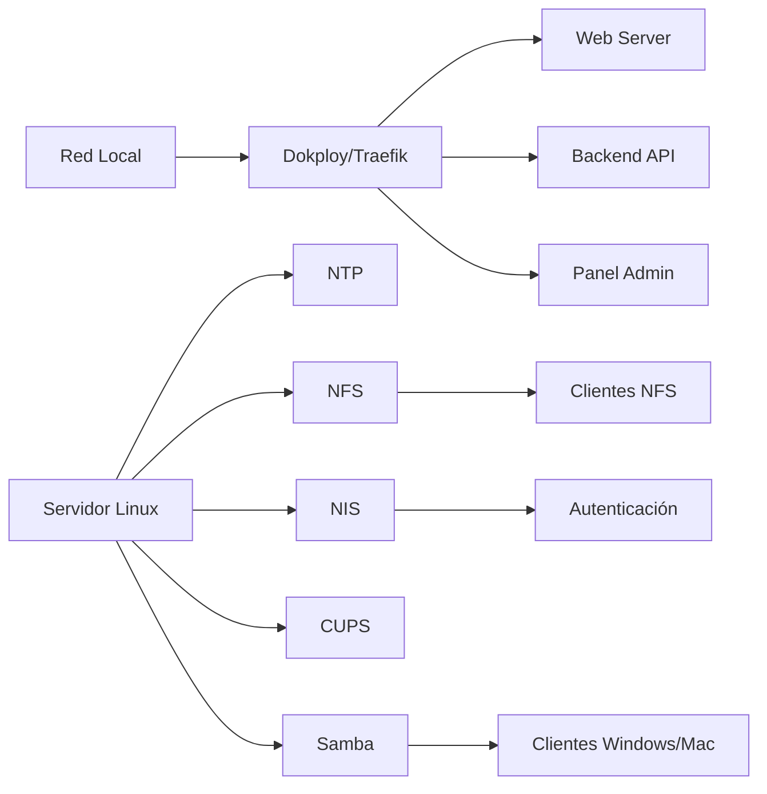

# Análisis y Diseño de Infraestructura TI - Grupo Nutresa

## **1. Contexto empresarial**

Grupo Nutresa S.A. es una empresa colombiana líder en alimentos procesados, con sede en Medellín y presencia directa en 18 países. Opera ocho unidades de negocio: Cárnicos, Galletas, Chocolates, Cafés, Tresmontes Lucchetti, Alimentos al Consumidor, Helados y Pastas.

La compañía desarrolla procesos de producción, comercialización y distribución de alimentos, además de servicios comerciales, logísticos y administrativos transversales. Su estrategia de transformación digital busca modernizar el núcleo tecnológico, mejorar la cadena de suministro, integrar sistemas mediante APIs y fortalecer la seguridad de sus activos digitales.

Para este proyecto se simula la infraestructura TI de una sede corporativa de Nutresa. El objetivo es centralizar, sobre un servidor Linux local, los servicios web, de archivos, de impresión, de sincronización horaria, de autenticación de usuarios y de acceso compartido, utilizando Dokploy como plataforma PaaS.

## **2. Necesidades identificadas**

| Necesidad | Problema o requerimiento | Servicio propuesto |
|---|---|---|
| Gestión de aplicaciones | Centralizar el despliegue, actualización y administración de aplicaciones web | Dokploy con Traefik como reverse proxy |
| Presencia digital institucional | Publicar información corporativa, marcas, productos y contacto de forma segura | Web Server (Nginx) desplegado con Dokploy |
| Lógica de negocio e integración | Procesar formularios y consultar noticias y productos desde la web | Backend API desplegada con Dokploy |
| Administración de la plataforma | Gestionar aplicaciones, dominios y certificados desde una interfaz web | Panel Admin (Dokploy) |
| Persistencia de datos | Almacenar información de la aplicación institucional | PostgreSQL mediante Dokploy |
| Nombre de dominio y cifrado | Acceder a los servicios por nombre y proteger el tráfico | Dominio/DNS dinámico y SSL/TLS (Let's Encrypt o autofirmado) |
| Sincronización de tiempo | Mantener la hora uniforme en servidores, estaciones y registros de auditoría | NTP |
| Archivos para Linux | Compartir documentación técnica, reportes y archivos operativos entre equipos Linux | NFS |
| Autenticación centralizada | Administrar usuarios y credenciales desde un punto central | NIS |
| Impresión compartida | Permitir que varias áreas usen impresoras de red desde una cola central | CUPS |
| Archivos para Windows/Mac | Compartir carpetas corporativas con equipos Windows y macOS | Samba |

## **3. Justificación de los servicios propuestos**

### **3.1 Dokploy y Traefik**
Dokploy permite administrar aplicaciones contenerizadas desde una interfaz centralizada. Se propone como plataforma PaaS para desplegar el sitio institucional, la API y la base de datos. Traefik actuará como reverse proxy, recibiendo el tráfico de la red local y enrutando las peticiones HTTP/HTTPS hacia los contenedores correspondientes, además de gestionar los certificados SSL/TLS.

**Justificación:** reduce la administración manual de servicios web, facilita despliegues reproducibles y centraliza el acceso seguro por HTTPS.

### **3.2 Web Server (Nginx)**
Se implementará un sitio institucional de Nutresa con información sobre sus unidades de negocio, marcas, productos y contacto corporativo.

**Justificación:** Nutresa requiere una presencia web segura para clientes, proveedores, inversionistas y empleados. El sitio será accesible mediante HTTPS y se ejecutará como contenedor en Dokploy, evitando instalar un servidor web en el host y así no generar conflictos con los puertos 80 y 443 de Traefik.

### **3.3 Backend API**
La API REST atenderá las solicitudes del sitio institucional: consulta de noticias y productos, y recepción de formularios de contacto. Se desplegará como aplicación en Dokploy y se conectará a PostgreSQL por la red interna de Docker.

**Justificación:** separa la presentación (sitio web) de la lógica y el acceso a datos, lo que evita exponer la base de datos y permite actualizar cada componente de forma independiente.

### **3.4 Panel Admin (Dokploy)**
El panel web de Dokploy será el punto de administración de aplicaciones, dominios, certificados y bases de datos. Se accederá mediante un subdominio con HTTPS a través de Traefik.

**Justificación:** concentra la gestión de la plataforma en una sola interfaz y su acceso se restringe a los administradores de TI.

### **3.5 Dominio/DNS y SSL/TLS**
El sitio y el panel se publicarán bajo un nombre de dominio (dominio gratuito o DNS dinámico), por ejemplo `nutresa-infra.duckdns.org`, con subdominios para cada servicio. Los certificados serán emitidos por Let's Encrypt a través de Traefik. Si la red no permite la validación HTTP-01 (por ejemplo, por CGNAT), se usará el desafío DNS-01 o, como alternativa, un certificado autofirmado.

**Justificación:** permite cifrar todo el tráfico web y evita acceder a los servicios por IP y puerto.

### **3.6 NTP**
El servicio NTP sincronizará la hora del servidor con una fuente confiable (`pool.ntp.org`) y ofrecerá esa hora a los clientes de la red local.

**Justificación:** la sincronización horaria es necesaria para registros de acceso, bitácoras, respaldos, autenticación y trazabilidad operativa. Evita inconsistencias entre equipos de la red. En la máquina virtual se desactivará la sincronización de hora del hipervisor para evitar conflictos con el servicio.

### **3.7 NFS**
NFS compartirá un directorio corporativo con las estaciones de trabajo Linux (Clientes NFS) de la sede simulada de Nutresa. Se usará NFSv4 para concentrar el tráfico en un solo puerto.

**Justificación:** permite centralizar archivos técnicos, reportes, documentos de calidad y material operativo, facilitando el acceso compartido entre los equipos Linux. El acceso estará restringido a la subred local, se mantendrá `root_squash` y los permisos se asignarán por grupo para proteger la información.

### **3.8 NIS**
NIS permitirá centralizar las cuentas de usuario y facilitar la autenticación de los clientes Linux de la red local bajo el dominio `nutresa.local`.

**Justificación:** evita crear manualmente el mismo usuario en cada equipo Linux y facilita la administración de usuarios para áreas como operaciones, logística, calidad y TI. Los UID/GID centralizados también hacen que los permisos de NFS sean consistentes entre equipos.

**Consideración de seguridad:** NIS es un protocolo antiguo que no cifra la información de las cuentas, por lo que su uso se limita a la red local, restringido por UFW y por la opción `securenets`. En un entorno productivo real se recomendaría migrar a LDAP o FreeIPA; aquí se usa por ser requisito del proyecto.

### **3.9 CUPS**
CUPS administrará las impresoras compartidas y sus colas de impresión dentro de la sede simulada de Nutresa.

**Justificación:** permite que los usuarios de diferentes áreas envíen trabajos de impresión a través de un servidor centralizado. Puede utilizarse para imprimir etiquetas internas, órdenes de producción, reportes de calidad, guías de despacho y documentos administrativos. Para las pruebas se usará una impresora virtual (`cups-pdf`) en caso de no contar con una impresora física.

### **3.10 Samba**
Samba compartirá carpetas corporativas con clientes Windows y macOS.

**Justificación:** permite interoperabilidad con los sistemas operativos de escritorio usados en oficinas, sin exponer directamente el sistema de archivos del servidor. Los usuarios se crean con `smbpasswd` y se agrupan en `sambausers`; no se habilita acceso de invitados.

### **3.11 PostgreSQL**
PostgreSQL almacenará los datos de la aplicación web institucional, como noticias, productos, información de contacto y formularios.

**Justificación:** es un sistema gestor de bases de datos relacional que permite almacenar y consultar la información de la aplicación. Se desplegará mediante Dokploy y el backend se conectará a través de la red interna de Docker, sin publicar el puerto 5432 hacia la red local ni hacia internet.

## **4. Diagrama de arquitectura**

El diagrama completo se encuentra en el archivo `diagrama.mmd`.

**Descripción:** el tráfico web de la red local llega a Dokploy/Traefik, que lo distribuye al Web Server, la Backend API y el Panel Admin. Por otro lado, el Servidor Linux ofrece NTP, NFS, NIS, CUPS y Samba: NFS atiende a los clientes Linux, Samba a los clientes Windows/Mac y NIS provee la autenticación centralizada. La base de datos PostgreSQL se despliega dentro de Dokploy y solo es accesible por la Backend API a través de la red interna de Docker.

## **5. Tabla de requisitos técnicos**

Servidor: Ubuntu Server, IP fija `192.168.1.10/24` (reserva DHCP o configuración estática). Dominio: `nutresa-infra.duckdns.org`. Dominio NIS: `nutresa.local`.

| Servicio | IP del servidor | Puerto | Protocolo | Tipo de servicio | Cliente o consumidor | Alcance |
|---|---|---|---|---|---|---|
| Dokploy / Traefik | 192.168.1.10 | 80, 443 | HTTP, HTTPS/TCP | Proxy inverso y SSL | Navegadores y aplicaciones | Red local |
| Panel Admin (Dokploy) | 192.168.1.10 | 443 (vía Traefik); 3000 solo durante la instalación | HTTPS/TCP | PaaS / Panel web | Administradores TI | Solo IPs de administradores |
| Web Server (Nginx) | 192.168.1.10 | 443 (vía Traefik) | HTTPS/TCP | Servidor web | Usuarios internos y externos | Según publicación |
| Backend API | 192.168.1.10 | 443 (vía Traefik, ruta `/api`) | HTTPS/TCP | API REST | Aplicación web | Red local |
| PostgreSQL | Red interna Docker | 5432 (no publicado) | TCP | Base de datos | Backend API | Solo red interna Docker |
| DNS / dominio | Proveedor externo | 53 (salida) | UDP/TCP | Resolución de nombres | Todos los equipos | Externo |
| Let's Encrypt (validación) | 192.168.1.10 | 80 (HTTP-01) o DNS-01 | TCP | Emisión de certificados | Traefik | Entrante solo en la validación |
| NTP | 192.168.1.10 | 123 | UDP | Sincronización horaria | Servidores y clientes Linux/Windows | Red local |
| NFS (v4) | 192.168.1.10 | 2049 | TCP | Compartición de archivos | Clientes NFS (Linux) | Subred 192.168.1.0/24 |
| NIS (portmapper) | 192.168.1.10 | 111 | TCP/UDP | Autenticación centralizada | Clientes Linux | Subred 192.168.1.0/24 |
| NIS (ypserv, puerto fijado) | 192.168.1.10 | 1011 | TCP/UDP | Autenticación centralizada | Clientes Linux | Subred 192.168.1.0/24 |
| NIS (yppasswdd, puerto fijado) | 192.168.1.10 | 1012 | TCP/UDP | Cambio de contraseña | Clientes Linux | Subred 192.168.1.0/24 |
| CUPS (IPP) | 192.168.1.10 | 631 | HTTP/HTTPS/TCP | Servidor de impresión | Clientes Linux y Windows | Subred 192.168.1.0/24 |
| Samba (SMB) | 192.168.1.10 | 445, 139 | TCP | Compartición de archivos | Clientes Windows/Mac | Subred 192.168.1.0/24 |
| Samba (NetBIOS) | 192.168.1.10 | 137, 138 | UDP | Resolución de nombres NetBIOS | Clientes Windows | Subred 192.168.1.0/24 |
| SSH administrativo | 192.168.1.10 | 22 | TCP | Administración remota | Administradores TI | Solo IPs de administradores |

**Nota:** los puertos 1011 y 1012 se fijan en `/etc/default/nis` (`YPSERVARGS="-p 1011"` y `YPPASSWDDARGS="--port 1012"`) para poder filtrarlos con UFW, ya que por defecto NIS usa puertos dinámicos.

## **6. Decisiones de diseño**

- Se usará **Ubuntu Server 22.04/24.04 LTS** por ser una distribución estable, ampliamente documentada y compatible con los servicios requeridos.
- Los servicios web, API y base de datos se desplegarán mediante **Dokploy**, mientras que NTP, NFS, NIS, CUPS y Samba se instalarán directamente en el servidor Linux.
- Se utilizará **Traefik** como punto único de entrada HTTP/HTTPS; no se instalará otro servidor web en el host para evitar conflictos de puertos.
- Se aplicará **HTTPS** al sitio institucional y al Panel Admin, que se accederá por subdominio a través de Traefik. El puerto 3000 se cerrará una vez configurado el dominio.
- La máquina virtual usará red en **modo bridged** con IP fija, de modo que los clientes de la red local puedan acceder a los servicios.
- Se usará **NFSv4** y se limitará a la subred local (`192.168.1.0/24`) con `root_squash` activo, para reducir el riesgo de acceso no autorizado.
- **NIS** se restringirá a la subred local mediante `securenets` y UFW, dado que no cifra la información de las cuentas.
- **Samba** requerirá autenticación de usuarios del grupo `sambausers`; no se habilitará acceso de invitados.
- **CUPS** permitirá administración desde la red local, con control de usuarios autorizados (`lpadmin`).
- **PostgreSQL** no se publicará fuera de la red interna de Docker.
- Se configurará **UFW** para permitir únicamente los puertos de la tabla de requisitos según su origen. El acceso administrativo a Dokploy y SSH estará restringido a los administradores de TI.

## **7. Beneficios esperados**

- Centralización de servicios en un solo servidor local.
- Administración más simple de aplicaciones mediante Dokploy.
- Acceso seguro al sitio institucional mediante HTTPS.
- Sincronización horaria confiable en toda la red.
- Archivos corporativos disponibles para Linux, Windows y macOS.
- Autenticación centralizada de usuarios Linux mediante NIS.
- Impresión compartida y controlada mediante CUPS.
- Base de datos integrada a la aplicación institucional.

## **8. Análisis costo-beneficio**

| Componente | Costo de licencia | Observación |
|---|---|---|
| Ubuntu Server | $0 | Software libre |
| Dokploy, Traefik, Docker | $0 | Software libre |
| Nginx, PostgreSQL | $0 | Software libre |
| NTP, NFS, NIS, CUPS, Samba | $0 | Incluidos en repositorios de Ubuntu |
| Certificados SSL (Let's Encrypt) | $0 | Renovación automática |
| Dominio | $0 (DNS dinámico gratuito) | Un dominio propio tendría un costo anual |
| Hardware | Servidor local existente | Costo de energía y mantenimiento |

**Costos:** al usar solo software libre, el costo se concentra en el tiempo de implementación y administración del personal de TI y en el hardware existente. Un equivalente con licencias (Windows Server, servidor de impresión y servicio de autenticación comerciales) implicaría costos recurrentes por licencia y acceso de clientes.

**Beneficios:** menor costo de licenciamiento, administración centralizada, despliegues reproducibles y una base de infraestructura que puede crecer.

**Riesgos y limitaciones:** un único servidor es un punto de falla (se mitiga con respaldos de configuración y snapshots de la VM), y NIS tiene limitaciones de seguridad (se mitiga restringiéndolo a la red local).