# Documentación Técnica — Infraestructura de TI Grupo Nutresa S.A.

**Curso:** Administración de Infraestructura de TI · Universidad del Quindío · Facultad de Ingeniería de Sistemas y Computación · Semestre 2026-1


## Índice

| # | Sección | Capturas |
|---|---|---|
| 1 | [Infraestructura base: virtualización con Multipass y red *bridged*](#sección-1-infraestructura-base-virtualización-multipass-y-red-bridged) | 01–08 |
| 2 | [Servicio NTP con Chrony](#sección-2-servicio-ntp-con-chrony) | 09–11 |
| 3 | [Servicio NFSv4](#sección-3-servicio-nfsv4-archivos-compartidos-para-linux) | 12–15 |
| 4 | [Servicio NIS](#sección-4-servicio-nis-autenticación-centralizada) | 18–19 |
| 5 | [Servicio Samba](#sección-5-servicio-samba-archivos-compartidos-para-windows-y-macos) | 20–21 |
| 6 | [Servicio CUPS](#sección-6-servicio-cups-servidor-de-impresión) | 22 |
| 7 | [Traefik, dominio y SSL/TLS](#sección-7-traefik-dominio-y-ssltls) | 16–17 |
| 8 | [Dokploy y PostgreSQL](#sección-8-dokploy-y-postgresql) | 23–24 |
| 9 | [Sitio web (Nginx) y Backend API desde Git](#sección-9-sitio-web-nginx-y-backend-api-desde-git) | 25 |

**Nodos implementados** (los valores de `analisis.md` proyectaban `192.168.1.10`; la implementación real quedó así):

| Nodo | Sistema | Recursos | IP | Rol |
|---|---|---|---|---|
| `nutresa-server` | Ubuntu 24.04.5 LTS (Multipass) | 2 vCPU · 4 GB RAM · 40 GB disco | `192.168.1.34/24` (`eth1`) | Servidor de servicios |
| `nutresa-cliente` | Ubuntu 24.04.5 LTS (Multipass) | 2 vCPU · 2 GB RAM · 20 GB disco | `192.168.1.35/24` | Cliente Linux de pruebas |
| `host-windows` | Windows 11 | — | `192.168.1.31/24` | Anfitrión de las VM y cliente Windows |

---


# Sección 1. Infraestructura base: virtualización Multipass y red *bridged*

**Objetivo.** Tener una máquina virtual Ubuntu Server 24.04 LTS con al menos 2 vCPU, 4 GB de RAM y 40 GB de disco, conectada en modo puente (*bridged*) a la red Wi-Fi local, para que los clientes de la red `192.168.1.0/24` puedan alcanzar sus servicios. Se crea además una segunda VM cliente para probar NTP, NFS, NIS, Samba y CUPS.

**Resumen de lo realizado**

1. Crear `nutresa-server` con Multipass.
2. Actualizar el sistema e instalar herramientas de administración.
3. Crear el switch virtual externo `Nutresa-External` en Hyper-V (puente hacia el Wi-Fi).
4. Asociar la VM al switch y obtener una IP dentro de `192.168.1.0/24`.
5. Crear `nutresa-cliente` y comprobar la comunicación entre ambos nodos.

## 1.1 Crear la máquina virtual del servidor

En **PowerShell del host Windows**:

```powershell
multipass launch 24.04 --name nutresa-server --cpus 2 --memory 4G --disk 40G
multipass list
multipass info nutresa-server
```

**Verificación.** `multipass info` debe mostrar `State: Running`, `Release: Ubuntu 24.04.5 LTS`, `CPU(s): 2`, disco ≈ 38,7 GiB y memoria ≈ 3,8 GiB.


*Captura 01a — `capturas/01a_crear_vm_launch_info.png`: creación de la VM con `multipass launch`, listado con `multipass list` e información con `multipass info`.*

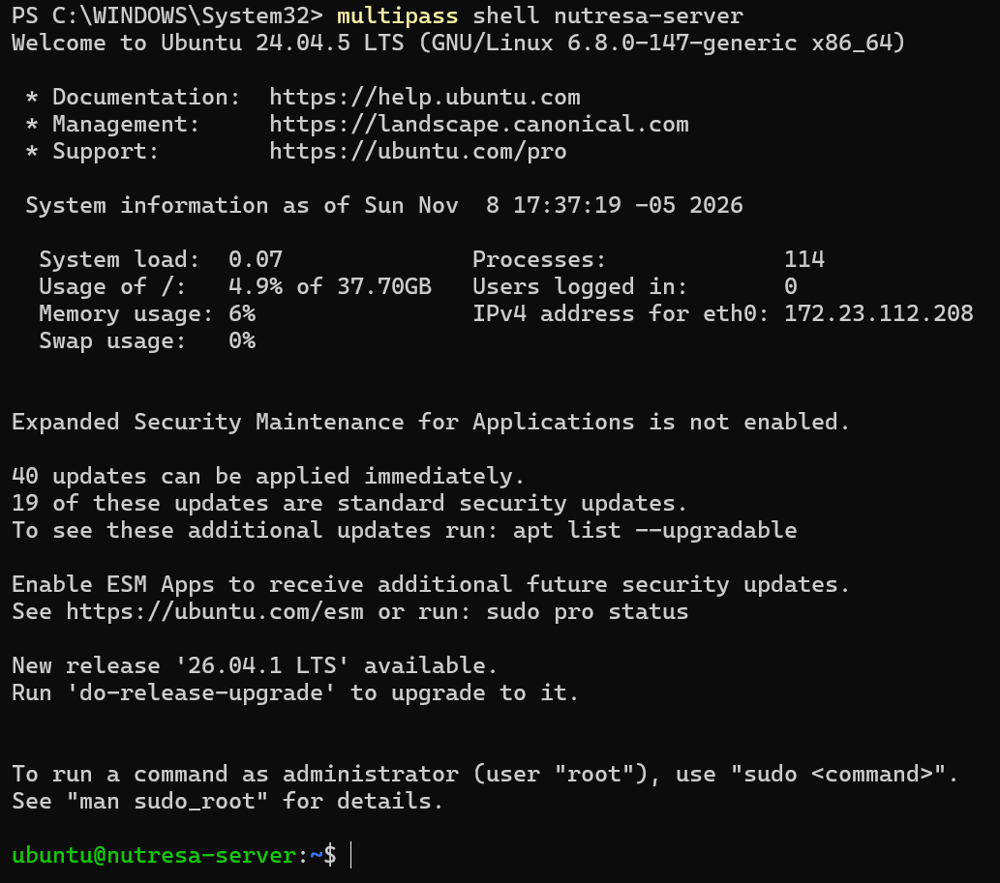

*Captura 01b — `capturas/01b_acceso_vm_multipass_shell.png`: ingreso a la VM con `multipass shell` y mensaje de bienvenida de Ubuntu 24.04.5 LTS.*

Se ingresa a la VM con:

```powershell
multipass shell nutresa-server
```

## 1.2 Actualizar el sistema e instalar herramientas de administración

Dentro de `nutresa-server`:

```bash
sudo apt update
sudo apt upgrade -y
sudo apt install -y curl wget git nano vim net-tools iproute2 dnsutils iputils-ping traceroute chrony openssh-server ufw
```

Estas herramientas permiten administrar el servidor (`nano`, `vim`), probar la conectividad (`ping`, `traceroute`, `dnsutils`), consultar la red (`ip`, `net-tools`), acceder de forma remota (`openssh-server`), sincronizar la hora (`chrony`) y gestionar el firewall (`ufw`).


*Captura 02a — `capturas/02a_apt_update_upgrade.png`: actualización del sistema con `apt update` y `apt upgrade`.*

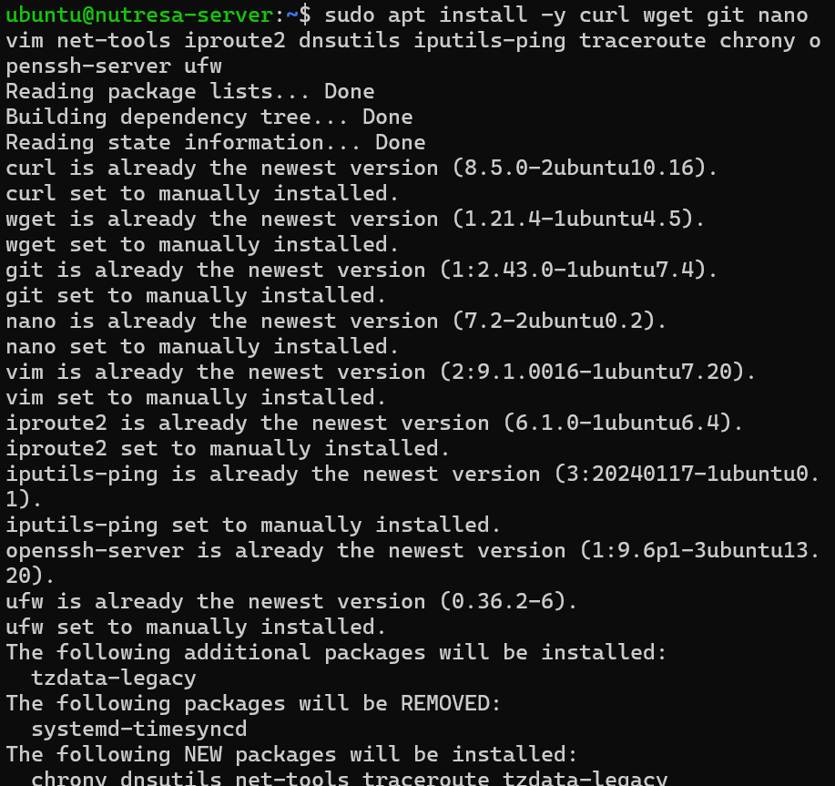

*Captura 02b — `capturas/02b_instalar_herramientas_base.png`: instalación de las herramientas de administración.*

### Nombre del servidor, salida a internet y SSH

Se fija el nombre del equipo, se verifica la red y la salida a internet, y se activa el acceso remoto por SSH:

```bash
sudo hostnamectl set-hostname nutresa-server
hostnamectl
ip -br addr
ip route
ping -c 4 8.8.8.8
ping -c 4 google.com
sudo systemctl enable --now ssh
sudo systemctl status ssh --no-pager
```

**Verificación.** `hostnamectl` muestra `Static hostname: nutresa-server`; ambos `ping` responden con 0 % de pérdida (prueba de salida a internet y de resolución DNS); `ssh` queda `enabled` y `active (running)`.

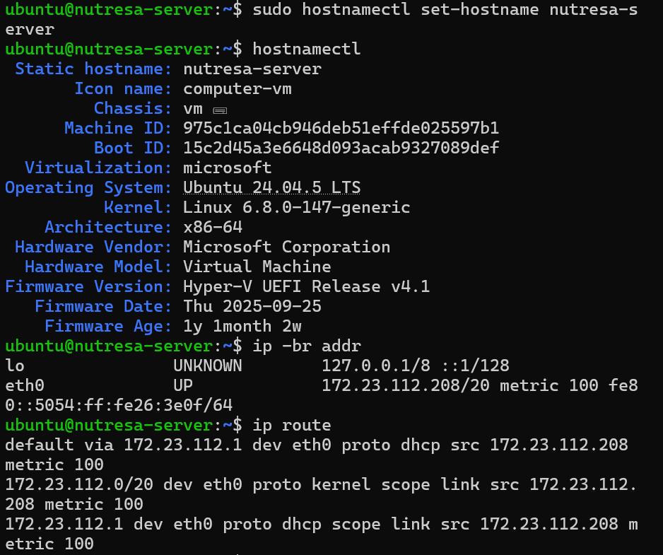

*Captura 02c — `capturas/02c_hostname_ip_ruta.png`: nombre del servidor (`hostnamectl set-hostname`), dirección IP y rutas (`ip -br addr`, `ip route`).*

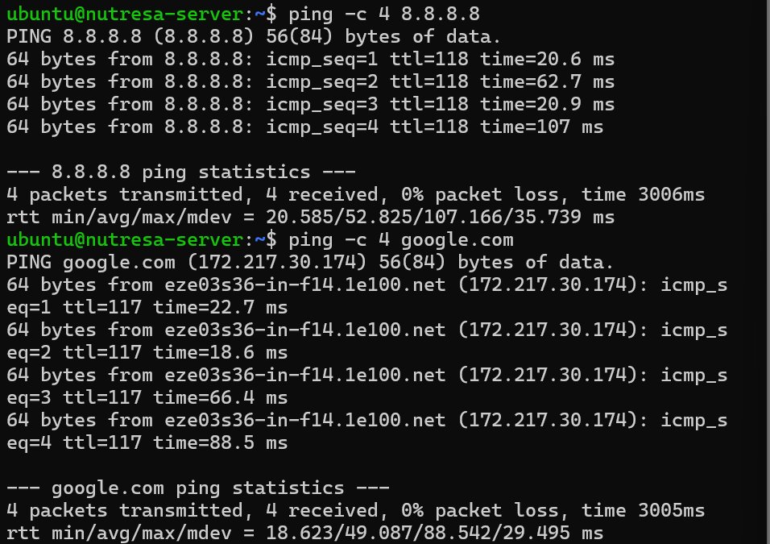

*Captura 02d — `capturas/02d_ping_internet.png`: comprobación de salida a internet con `ping` a `8.8.8.8` y a `google.com`.*


*Captura 02e — `capturas/02e_ssh_activo.png`: activación del servicio SSH y verificación de su estado.*

## 1.3 Red: crear el switch externo (modo *bridged*)

Por defecto Multipass en Hyper-V conecta la VM al **Default Switch** (red NAT interna, en este caso `172.x.x.x`), que **no** pertenece a la red Wi-Fi `192.168.1.0/24`. Para que la VM sea accesible desde la red local se crea un switch virtual **externo** ligado al adaptador Wi-Fi.

1. Listar las redes que conoce Multipass y los adaptadores del host:

   ```powershell
   multipass networks
   Get-NetAdapter | Format-Table Name, InterfaceDescription, Status
   ```

   Solo aparecen `Default Switch` y `WSL (Hyper-V firewall)`. El adaptador físico a usar es `Wi-Fi` (Realtek RTL8852AE WiFi 6).

2. Intentar consultar los switches existentes:

   ```powershell
   Get-VMSwitch | Format-Table Name, SwitchType, NetAdapterInterfaceDescription
   ```

   

   *Captura 03a — `capturas/03a_multipass_networks_error_permisos.png`: `multipass networks`, `Get-NetAdapter` y el error de `Get-VMSwitch` por falta de permisos (ver Problema 1.A).*

   

   *Captura 03b — `capturas/03b_ip_host_get_netipconfiguration.png`: `Get-NetIPConfiguration` en el host: las interfaces virtuales usan direcciones `172.x.x.x`, fuera de la red Wi-Fi.*

3. Crear el switch externo (PowerShell **como administrador**):

   ```powershell
   New-VMSwitch -Name "Nutresa-External" -NetAdapterName "Wi-Fi" -AllowManagementOS $true
   ```

   `-AllowManagementOS $true` mantiene el acceso a internet del host a través del mismo adaptador.

   

   *Captura 04a — `capturas/04a_crear_switch_Nutresa-External.png`: creación del switch externo `Nutresa-External` con `New-VMSwitch`.*

   

   *Captura 04b — `capturas/04b_comprobar_switch_externo.png`: comprobación con `Get-VMSwitch` y `multipass networks`: el switch aparece como `External`.*

   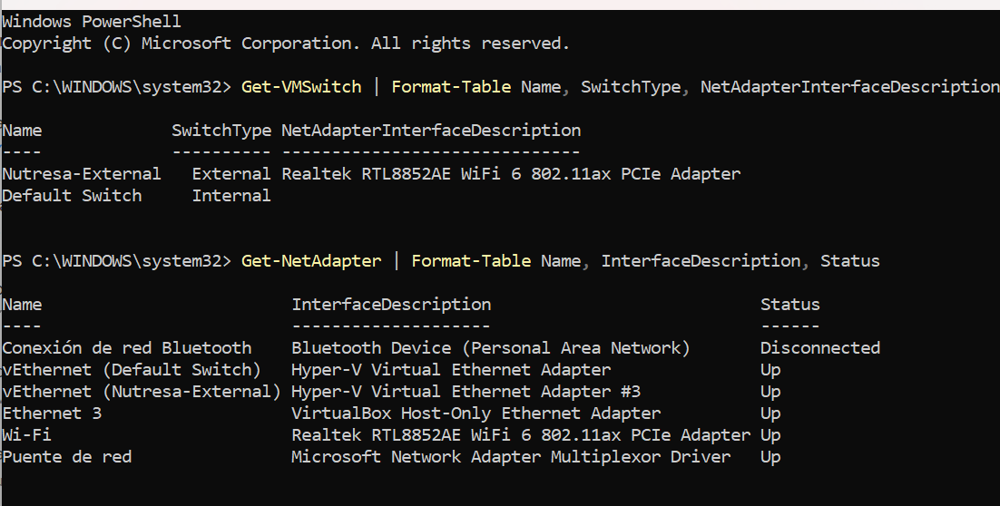

   *Captura 04c — `capturas/04c_verificar_switch_segundo_intento.png`: verificación del switch y de los adaptadores con `Get-VMSwitch` y `Get-NetAdapter` (segundo intento).*

4. Comprobar:

   ```powershell
   Get-VMSwitch | Format-Table Name, SwitchType, NetAdapterInterfaceDescription
   ```

   Debe listar `Nutresa-External — External — Realtek RTL8852AE WiFi 6 802.11ax PCIe Adapter` junto a `Default Switch — Internal`.

## 1.4 Asociar la VM al switch y obtener IP en `192.168.1.0/24`

Con la VM detenida se le asigna la red puente y se vuelve a iniciar:

```powershell
multipass stop nutresa-server
multipass set local.bridged-network=Nutresa-External
multipass set local.nutresa-server.bridged=true
multipass start nutresa-server
multipass list
multipass shell nutresa-server
```

Dentro de la VM se verifica la interfaz nueva `eth1`:

```bash
ip -br addr
ip route
```

Obtener una IP correcta en la red local tomó dos intentos (resumen en la sección 1.9).

### Intento 1: la VM toma la misma IP del host

Al arrancar con el switch externo, `eth1` recibió `192.168.1.31`, que es **la misma IP del host Windows**. Dos equipos con la misma dirección generan un conflicto, así que esa IP no se puede usar (Problema 1.B).


*Captura 05a — `capturas/05a_asociar_switch_bridged.png`: la VM se detiene, se asocia a la red puente y se reinicia (`multipass list` muestra `192.168.1.31`).*


*Captura 05b — `capturas/05b_conflicto_ip_con_host_windows.png`: `ip -br addr` dentro de la VM: `eth1` tomó `192.168.1.31`, igual a la IP del host Windows (ver Problema 1.B).*

### Intento 2: asignar manualmente una IP libre

Se comprobó con `arping` que `192.168.1.10` (la IP proyectada en `analisis.md`) estaba libre (`Received 0 response(s)`) y se asignó a `eth1` a mano:

```bash
sudo arping -D -I eth1 -c 4 192.168.1.10      # 0 respuestas => la IP está libre
sudo ip -4 addr flush dev eth1
sudo ip addr add 192.168.1.10/24 dev eth1
sudo ip link set eth1 up
ip -4 -br address
```


*Captura 06 — `capturas/06_asignacion_ip_eth1.png`: comprobación con `arping` y asignación manual de `192.168.1.10/24` en `eth1`.*

Esta asignación **no es persistente**: se pierde al reiniciar la VM, por lo que no quedó como configuración definitiva.

### Resultado final

Con el switch externo verificado, el servidor quedó con estas direcciones (`ip -br addr`):

```text
lo      UNKNOWN   127.0.0.1/8 ::1/128
eth0    UP        172.31.38.240/20          # red interna de Hyper-V (Default Switch)
eth1    UP        192.168.1.34/24           # red Wi-Fi local (switch Nutresa-External)
```

`eth1` tiene `192.168.1.34/24` con puerta de enlace `192.168.1.1`. La IP `192.168.1.34` es la dirección de servicio de `nutresa-server` en todo el proyecto.

**IP de servicio fija.** Como `eth1` recibe su dirección por DHCP, esta puede cambiar cuando la VM cambia de red (ver Problema 1.E). Para que `192.168.1.34` no se pierda, se configuró como **dirección adicional** en `eth1`, manteniendo el DHCP activo. Se revisa el archivo de Netplan y las direcciones de la interfaz con:

```bash
sudo cat /etc/netplan/*.yaml
ip -4 addr show eth1
```

Con esto, si el DHCP entrega otra dirección, el servidor sigue respondiendo en `192.168.1.34` y los servicios (NTP, NFS, etc.) no dejan de funcionar. Los pasos detallados de esa configuración son los siguientes.

### Configuración detallada de la IP fija en Netplan

**Paso 1 — Revisar la red actual de la VM.** Se revisan las interfaces y las rutas para identificar cuál es la red local: `eth0` es la red interna de Hyper-V y `eth1` es la red Wi-Fi `192.168.1.x`:

```bash
ip -br addr
ip route
ls -l /etc/netplan/
sudo cat /etc/netplan/*.yaml
```

**Paso 2 — Comprobar que `192.168.1.34` está libre.** Antes de usarla se probó con un `ping` desde Windows:

```powershell
ping 192.168.1.34
```

El ping devolvió «Respuesta desde 192.168.1.14: Host de destino inaccesible», es decir, la dirección estaba libre.

**Paso 3 — Crear la configuración de Netplan.** No se modificó el archivo original (`50-cloud-init.yaml`, generado por cloud-init): se hizo una copia de seguridad y se creó un archivo adicional que solo añade la IP:

```bash
sudo mkdir -p /root/backup-red
sudo cp -a /etc/netplan/50-cloud-init.yaml /root/backup-red/50-cloud-init.yaml.bak
sudo nano /etc/netplan/60-nutresa.yaml
```

Contenido de `60-nutresa.yaml`:

```yaml
network:
  version: 2
  ethernets:
    extra0:
      addresses:
        - 192.168.1.34/24
```

Se ajustan permisos y se valida la configuración:

```bash
sudo chown root:root /etc/netplan/60-nutresa.yaml
sudo chmod 600 /etc/netplan/60-nutresa.yaml
sudo netplan generate
sudo netplan get
```

**Paso 4 — Aplicar la configuración de forma segura.** `netplan try` aplica el cambio y lo revierte automáticamente a los 120 segundos si no se confirma:

```bash
sudo netplan try --timeout 120
```

Se confirma con Enter y luego se verifica dentro de la VM:

```bash
ip -br addr
ip route
sudo docker node ls
```

Y desde Windows:

```powershell
ping 192.168.1.34
arp -a | findstr 192.168.1.34
```

## 1.5 Crear el nodo cliente

En PowerShell:

```powershell
multipass launch 24.04 --name nutresa-cliente --cpus 2 --memory 2G --disk 20G
multipass shell nutresa-cliente
```

Dentro del cliente se actualiza e instalan las herramientas de cliente de todos los servicios del proyecto:

```bash
sudo apt update
sudo apt upgrade -y
sudo apt install -y openssh-client nfs-common nis rpcbind samba-client cups-client chrony
```


*Captura 07a — `capturas/07a_crear_nutresa_cliente.png`: creación de `nutresa-cliente` y primer acceso.*


*Captura 07b — `capturas/07b_herramientas_cliente.png`: actualización del cliente e instalación de sus herramientas.*

Al crearse, la VM recibe una IP de la red interna (NAT) del hipervisor: `10.0.2.15` en la interfaz `enp0s3`, que **no pertenece** a la red local y desde la que no se alcanza el servidor. Por eso, después de crearla, se le asignó una **nueva IP dentro del rango de la red local**, `192.168.1.35/24`, que es la que usa el cliente en todas las pruebas (visible como `clientaddr=192.168.1.35` en el montaje NFS de la Sección 3). Las dos situaciones quedaron registradas en las capturas del cliente.

## 1.6 Verificar la comunicación entre nodos

Desde `nutresa-cliente`:

```bash
ping -c 4 192.168.1.34
```

**Resultado esperado y obtenido:** `4 packets transmitted, 4 received, 0% packet loss` (latencias entre ≈ 8 y 70 ms por el medio Wi-Fi).


*Captura 08 — `capturas/08_ping_cliente_servidor.png`: conectividad cliente → servidor.*

## 1.7 Lista de verificación de la Sección 1

| Verificación | Comando | Resultado esperado | Captura |
|---|---|---|---|
| VM con recursos correctos | `multipass info nutresa-server` | 2 CPU · 3,8 GiB · 38,7 GiB · Ubuntu 24.04.5 LTS | 01 |
| Herramientas instaladas | `dpkg -l chrony ufw openssh-server` | estado `ii` | 02 |
| Switch externo | `Get-VMSwitch` | `Nutresa-External` tipo `External` | 04 |
| IP en la red local | `ip -br addr` | `eth1 192.168.1.34/24` | 05, 06 |
| Cliente → servidor | `ping -c 4 192.168.1.34` | 0 % de pérdida | 08 |

## 1.8 Solución de problemas de la Sección 1

| # | Problema | Causa | Solución |
|---|---|---|---|
| 1.A | La VM obtenía `172.x.x.x`, fuera de la red Wi-Fi, y `Get-VMSwitch` fallaba con *"No dispone del permiso necesario"* (Captura 03). | Multipass usaba el *Default Switch* (NAT) y PowerShell se ejecutaba sin privilegios de administrador / sin pertenecer a *Hyper-V Administrators*. | Abrir PowerShell **como administrador** y crear el switch externo `Nutresa-External` (Captura 04). |
| 1.B | Tras asociar el switch, la VM tomó `192.168.1.31`, la **misma IP del host Windows** (Captura 05). | Conflicto de direccionamiento con la IP ya usada por el anfitrión. | Verificar con `arping -D` una IP libre y reasignar `eth1` (Captura 06); la VM quedó finalmente con `192.168.1.34/24`. |
| 1.C | Dos rutas por defecto (`eth0` métrica 100 y `eth1` métrica 200). | La VM tiene dos interfaces (Default Switch y puente). | No requiere acción: el tráfico a `192.168.1.0/24` sale por `eth1` (ruta de red directa); los servicios se anuncian siempre con `192.168.1.34`. |
| 1.D | `ping 192.168.1.10` desde el cliente devolvía respuestas duplicadas y datos erróneos (*wrong data byte*, *DUP!*). | `192.168.1.10` era la IP proyectada en `analisis.md` y ya no pertenece al servidor. | Usar `192.168.1.34`, que respondió con 0 % de pérdida (Captura 08). |
| 1.E | La IP de la VM cambiaba: al principio era `192.168.1.34` y después pasó a `192.168.1.11`. | `eth1` la recibe por DHCP y la VM se movió de red. | Se fijó `192.168.1.34` como dirección adicional en `eth1` (Netplan), manteniendo el DHCP; así, si la VM cambia de red, conserva conectividad en la IP de servicio. |
| 1.F | El cliente no alcanzaba al servidor: `ip route get 192.168.1.34` salía por `10.0.2.2` (NAT) y el montaje NFS fallaba con `Operation not permitted`. | La VM del cliente se crea con una IP de la red NAT (`10.0.2.15`), fuera de `192.168.1.0/24`. | Asignarle una IP dentro del rango de la red local (`192.168.1.35/24`) y repetir las pruebas (ver también 3.B). |

## 1.9 Registro de intentos

La red del servidor se resolvió en dos intentos:

| Intento | Fecha | Qué se hizo | Resultado |
|---|---|---|---|
| 1 | 8 de noviembre de 2026 | Se creó `nutresa-server` con el *Default Switch* de Hyper-V y se accedió, actualizó y configuró (capturas 01 a 02e). Se revisó la red del host (captura 03). | La VM quedó en `172.23.112.208`, fuera de `192.168.1.0/24`. Se creó el switch externo `Nutresa-External` (captura 04) y se asoció a la VM. |
| 1 (continuación) | 8 de noviembre de 2026 | Al asociar el switch, `eth1` tomó `192.168.1.31`, la misma IP del host (captura 05). Se probó una IP manual libre, `192.168.1.10` (captura 06). | Conflicto de IP; la asignación manual no es persistente. |
| 2 | 10 de noviembre de 2026 | Se verificó el switch externo (captura 04). El servidor mostró `eth0 172.31.38.240` (red interna) y `eth1 192.168.1.34/24` (red local). Se creó `nutresa-cliente` (captura 07) y se probó la comunicación (captura 08). | Configuración definitiva: IP de servicio `192.168.1.34`, fijada además como dirección adicional en `eth1`. |

---

# Sección 2. Servicio NTP con Chrony

**Objetivo.** Que `nutresa-server` sincronice su reloj con una fuente confiable de internet y actúe como **servidor NTP de la red local** (puerto `123/udp`), de modo que `nutresa-cliente` se sincronice contra `192.168.1.34`. La hora uniforme es necesaria para registros de auditoría, bitácoras, certificados SSL y autenticación.

**Decisión de diseño.** La guía del curso usa el paquete `ntp` (`ntpq -p`). En Ubuntu 24.04 el servicio estándar y mantenido es **Chrony**, que cumple la misma función (cliente y servidor NTP) y se verifica con `chronyc`. Los pasos de la guía se mantienen: instalar, configurar, habilitar y verificar.

| Parámetro | Valor |
|---|---|
| Servidor NTP | `nutresa-server` · `192.168.1.34` |
| Paquete / servicio | `chrony` (`chrony.service`) |
| Puerto | `123/udp` |
| Fuentes externas | `ntp.ubuntu.com` y `*.ubuntu.pool.ntp.org` (las de Ubuntu por defecto) |
| Clientes autorizados | `192.168.1.0/24` |
| Configuración | `codigo/chrony.conf` |

## 2.1 Servidor: instalar y habilitar Chrony

En `nutresa-server`:

```bash
sudo apt update
sudo apt install -y chrony
sudo systemctl enable --now chrony
sudo systemctl status chrony
```

**Verificación.** El servicio debe aparecer `enabled` y `Active: active (running)`; en el registro se ve la selección de fuente (`Selected source ... ntp.ubuntu.com`).

También se activó la sincronización del sistema:

```bash
timedatectl
sudo timedatectl set-ntp true
timedatectl status
```

Resultado: `Time zone: America/Bogota (-05, -0500)`, `System clock synchronized: yes`, `NTP service: active`.

## 2.2 Servidor: permitir que los clientes de la red local consulten la hora

Se edita el archivo de configuración:

```bash
sudo nano /etc/chrony/chrony.conf
```

Al final del archivo se agrega:

```text
# Servidor NTP de Nutresa
allow 192.168.1.0/24
# Permitir sincronizacion de clientes de la red local
```

La directiva `allow` autoriza a los equipos de `192.168.1.0/24` a usar este servidor como fuente de hora (sin ella, Chrony solo actúa como cliente). Se reinicia el servicio:

```bash
sudo systemctl restart chrony
```

## 2.3 Servidor: verificar fuentes y estado de sincronización

```bash
chronyc sources -v
chronyc tracking
```

- `chronyc sources -v`: lista las fuentes; la marcada `^*` es la mejor fuente actual (`alphyn.canonical.com`, estrato 2).
- `chronyc tracking`: muestra el estado. Valores obtenidos: `Reference ID : 5BBD5B9D (alphyn.canonical.com)`, `Stratum : 3`, `System time : 0.000137431 seconds fast of NTP time`, `Leap status : Normal`.

El servidor queda en **estrato 3**: toma la hora de una fuente de estrato 2 y la ofrece a los clientes.

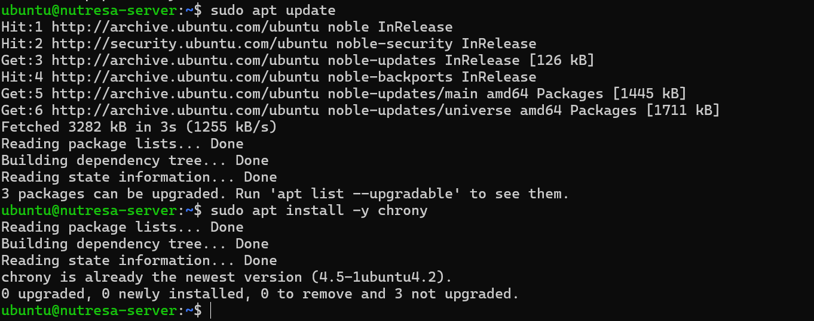

*Captura 09a — `capturas/09a_chrony_paquetes_basicos.png`: actualización del sistema e instalación de `chrony`.*

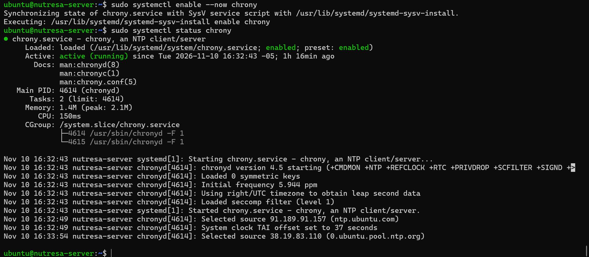

*Captura 09b — `capturas/09b_chrony_servicio_activo.png`: activación del servicio `chrony` y verificación de su estado.*

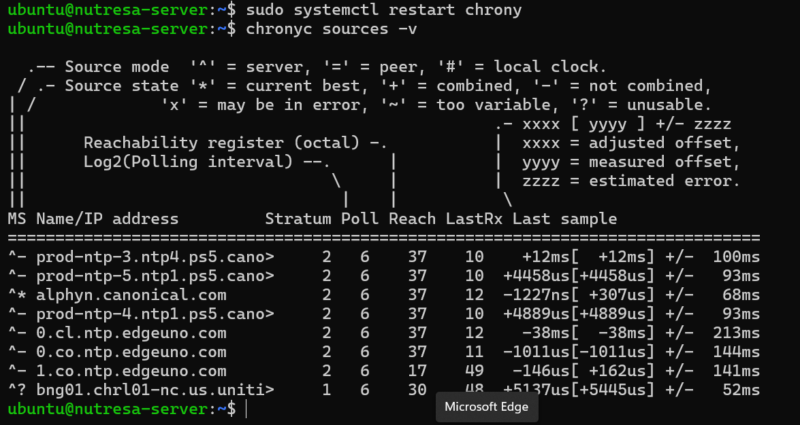

*Captura 09c — `capturas/09c_chrony_fuentes_servidor.png`: reinicio del servicio y fuentes de hora con `chronyc sources -v`.*

## 2.4 Servidor: abrir el puerto NTP en el firewall

```bash
sudo ufw allow from 192.168.1.0/24 to any port 123 proto udp
```

Salida: `Rules updated`. La regla permite `123/udp` únicamente desde la subred local.


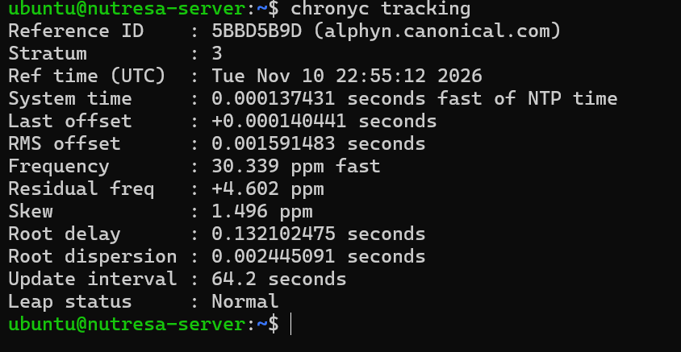

*Captura 10a — `capturas/10a_chrony_tracking.png`: estado de sincronización con `chronyc tracking` (estrato 3, `Leap status: Normal`).*

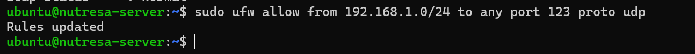

*Captura 10b — `capturas/10b_ufw_puerto_123.png`: regla de firewall para `123/udp` desde `192.168.1.0/24`.*

## 2.5 Cliente: sincronizar contra el servidor local

En `nutresa-cliente`:

```bash
sudo timedatectl set-ntp true
sudo apt install -y chrony
sudo nano /etc/chrony/chrony.conf     # agregar la línea:  server 192.168.1.34 iburst
sudo systemctl enable --now chrony
sudo systemctl restart chrony
chronyc sources -v
chronyc tracking
```

**Resultado obtenido:**

```text
MS Name/IP address         Stratum Poll Reach LastRx Last sample
^* 192.168.1.34                  3   6    37     4    +52us[ +599us] +/-   71ms
```

`chronyc tracking` en el cliente: `Reference ID : C0A80122 (192.168.1.34)`, `Stratum : 4`, `System time : 0.000299279 seconds fast of NTP time`, `Leap status : Normal`. Es decir, el cliente se sincroniza con `192.168.1.34` (`C0A80122` es esa IP en hexadecimal) y queda un estrato por debajo del servidor.

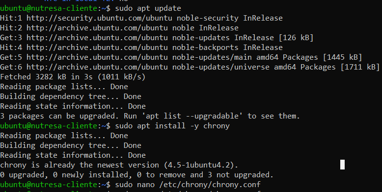

*Captura 11a — `capturas/11a_chrony_cliente_configuracion.png`: cliente: actualización, instalación de `chrony` y edición de `/etc/chrony/chrony.conf`.*


*Captura 11b — `capturas/11b_chrony_cliente_sincronizado.png`: cliente: `chronyc sources -v` con `^* 192.168.1.34` como fuente seleccionada.*

## 2.6 Lista de verificación de la Sección 2

| Verificación | Comando | Resultado esperado | Captura |
|---|---|---|---|
| Servicio activo | `systemctl status chrony` | `active (running)` | 09 |
| Fuente externa elegida | `chronyc sources -v` (servidor) | una fuente `^*` | 09 |
| Servidor sincronizado | `chronyc tracking` (servidor) | `Stratum 3`, `Leap status: Normal` | 10 |
| Puerto abierto a la LAN | `sudo ufw status` / regla `123/udp` | `192.168.1.0/24` → `123/udp` | 10 |
| Cliente sincronizado con el servidor | `chronyc sources -v` (cliente) | `^* 192.168.1.34` | 11 |

## 2.7 Solución de problemas de la Sección 2

| # | Problema | Causa | Solución |
|---|---|---|---|
| 2.A | Dudas de que `chrony` y `systemd-timesyncd` compitan por la hora. | Ambos son clientes NTP. | Al instalar `chrony`, APT retira `systemd-timesyncd`; `timedatectl` sigue mostrando `NTP service: active` (ahora gestionado por Chrony). |
| 2.B | Tras reiniciar Chrony, algunas fuentes externas aparecen con `^?` (p. ej. `alphyn.canonical.com`). | Aún no acumulan suficientes muestras (`Reach 17` octal indica que apenas empiezan a responder). | No requiere acción: esperar uno o dos intervalos de sondeo (≈ 64 s) y repetir `chronyc sources -v`. La fuente local `192.168.1.34` ya aparece como `^*` (Captura 11). |
| 2.C | El cliente no consulta al servidor. | Falta `allow` en el servidor o el puerto `123/udp` está bloqueado. | Verificar `allow 192.168.1.0/24` en `/etc/chrony/chrony.conf`, reiniciar `chrony` y revisar la regla UFW `123/udp`. |

---

# Sección 3. Servicio NFSv4 (archivos compartidos para Linux)

**Objetivo.** Compartir el directorio corporativo `/srv/nfs/nutresa` del servidor con los clientes Linux de la red `192.168.1.0/24` mediante **NFSv4**, con acceso por grupo y montaje permanente en el cliente.

**Decisiones de diseño** (se mantienen los pasos de la guía; se endurece la configuración):

- **NFSv4** con `fsid=0`: toda la exportación viaja por un único puerto, `2049/tcp`.
- **`root_squash`** activo (la guía de ejemplo usa `no_root_squash`, que no es recomendable): el `root` remoto no tiene privilegios de `root` en el servidor.
- Acceso restringido a la subred `192.168.1.0/24`.
- Permisos por **grupo**: grupo `nutresa` con **GID 2000** igual en servidor y cliente, porque NFS identifica a los usuarios por UID/GID numéricos. El directorio usa `2770` (bit *setgid*), de modo que los archivos nuevos heredan el grupo `nutresa`.

| Parámetro | Valor |
|---|---|
| Servidor | `192.168.1.34` · paquete `nfs-kernel-server` |
| Directorio exportado | `/srv/nfs/nutresa` (`root:nutresa`, `2770`) |
| Grupo | `nutresa` · GID `2000` |
| Puerto | `2049/tcp` |
| Punto de montaje (cliente) | `/mnt/nutresa` |
| Configuración | `codigo/exports` |

## 3.1 Servidor: instalar y activar NFS

En `nutresa-server`:

```bash
sudo apt update
sudo apt install -y nfs-kernel-server
sudo systemctl enable --now nfs-kernel-server
sudo systemctl status nfs-kernel-server
```

**Verificación.** El servicio `nfs-server.service` aparece `enabled` y `active (exited)` (es normal: lanza procesos del kernel y termina). Mientras `/etc/exports` no existe, el log muestra `exportfs: can't open /etc/exports for reading` (ver Problema 3.A).

## 3.2 Servidor: crear el grupo y el directorio compartido

```bash
sudo groupadd -g 2000 nutresa
sudo mkdir -p /srv/nfs/nutresa
sudo chown root:nutresa /srv/nfs/nutresa
sudo chmod 2770 /srv/nfs/nutresa
ls -ld /srv/nfs/nutresa
```

Resultado: `drwxrws--- 2 root nutresa 4096 ... /srv/nfs/nutresa`.

El `2` de `2770` activa el bit **setgid** (la `s` en `rws`): los archivos y subdirectorios nuevos heredan el grupo `nutresa`. Solo `root` y los miembros del grupo pueden leer y escribir (`770`).

## 3.3 Servidor: configurar la exportación

```bash
sudo nano /etc/exports
```

Contenido (también en `codigo/exports`):

```text
/srv/nfs/nutresa 192.168.1.0/24(rw,sync,no_subtree_check,root_squash,fsid=0)
```

| Opción | Función |
|---|---|
| `rw` | Permite lectura y escritura |
| `sync` | Confirma las escrituras de forma sincronizada (más seguro ante fallos) |
| `no_subtree_check` | Evita comprobaciones adicionales de subdirectorios |
| `root_squash` | El `root` remoto se convierte en usuario sin privilegios (`nobody`) |
| `fsid=0` | Define la **raíz de exportación NFSv4** |


*Captura 12a — `capturas/12a_nfs_instalar_servidor.png`: instalación de `nfs-kernel-server`.*

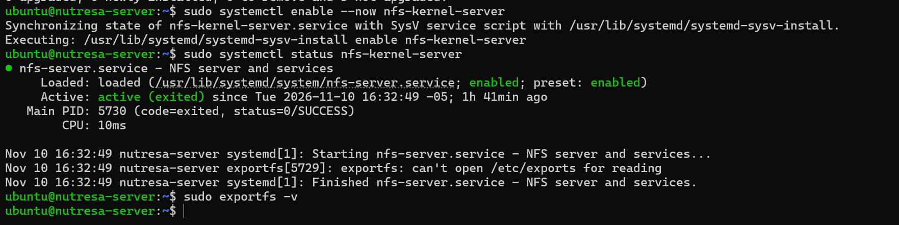

*Captura 12b — `capturas/12b_nfs_servicio_activo.png`: activación del servicio NFS y comprobación de su estado.*


*Captura 12c — `capturas/12c_nfs_grupo_nutresa_gid2000.png`: creación del grupo `nutresa` (GID 2000), del directorio `/srv/nfs/nutresa` y asignación de permisos `2770`.*

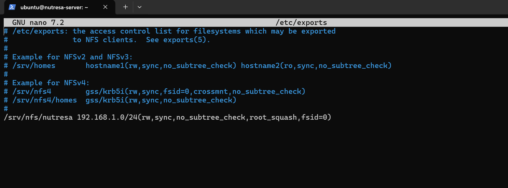

*Captura 12d — `capturas/12d_nfs_directorio_y_exports.png`: archivo `/etc/exports` con la línea de exportación.*

Aplicar y verificar:

```bash
sudo exportfs -ra
sudo exportfs -v
sudo ss -lntp | grep 2049
sudo ufw allow from 192.168.1.0/24 to any port 2049 proto tcp
```

**Resultado esperado y obtenido:**

```text
/srv/nfs/nutresa
        192.168.1.0/24(sync,wdelay,hide,no_subtree_check,fsid=0,sec=sys,rw,secure,root_squash,no_all_squash)
LISTEN 0 64  0.0.0.0:2049  0.0.0.0:*
LISTEN 0 64     [::]:2049     [::]:*
```


*Captura 13a — `capturas/13a_nfs_exportfs.png`: `exportfs -ra` y `exportfs -v`: subred autorizada y opciones aplicadas.*


*Captura 13b — `capturas/13b_nfs_puerto_2049.png`: puerto `2049` en escucha (`ss -lntp`).*

## 3.4 Cliente: instalar herramientas y montar el recurso

En `nutresa-cliente`:

```bash
sudo apt update
sudo apt install -y nfs-common
showmount -e 192.168.1.34
```

`showmount` debe listar: `/srv/nfs/nutresa 192.168.1.0/24`.

Se crea el **mismo grupo con el mismo GID** y se agrega al usuario:

```bash
sudo groupadd -g 2000 nutresa
sudo usermod -aG nutresa ubuntu
getent group nutresa          # nutresa:x:2000:ubuntu
newgrp nutresa
id                            # gid=2000(nutresa) groups=2000(nutresa),...
```

Se crea el punto de montaje y se monta:

```bash
sudo mkdir -p /mnt/nutresa
sudo mount -t nfs4 192.168.1.34:/ /mnt/nutresa
df -hT /mnt/nutresa
mount | grep nutresa
```


**Verificación.** `df -hT` muestra `192.168.1.34:/  nfs4  38G ... /mnt/nutresa` y `mount` indica `type nfs4 (rw,...,vers=4.2,...,proto=tcp,...,clientaddr=192.168.1.35)`: protocolo NFSv4.2 sobre TCP desde el cliente `192.168.1.35`.

## 3.5 Prueba de lectura y escritura cliente → servidor

Desde el cliente:

```bash
touch /mnt/nutresa/prueba_cliente.txt
echo "Prueba NFS desde el cliente Nutresa" > /mnt/nutresa/prueba_cliente.txt
cat /mnt/nutresa/prueba_cliente.txt
```

Para comprobarlo del lado del servidor:

```bash
ls -l /srv/nfs/nutresa/
```

Aquí apareció `Permission denied` (Problema 3.C): el usuario `ubuntu` del servidor aún no pertenecía al grupo `nutresa`. Se corrigió con:

```bash
sudo usermod -aG nutresa ubuntu
newgrp nutresa
groups
ls -l /srv/nfs/nutresa/
cat /srv/nfs/nutresa/prueba_cliente.txt
```

Resultado: `-rw-rw-r-- 1 ubuntu nutresa 36 ... prueba_cliente.txt` con contenido `Prueba NFS desde el cliente Nutresa`.

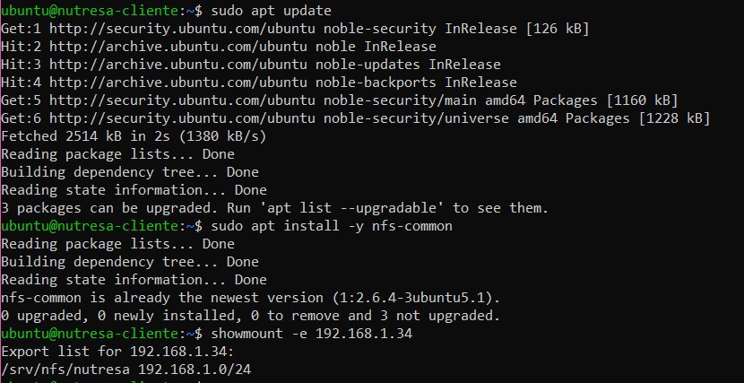

*Captura 14a — `capturas/14a_nfs_cliente_instalar_herramientas.png`: cliente: instalación de `nfs-common` y consulta con `showmount -e 192.168.1.34`.*

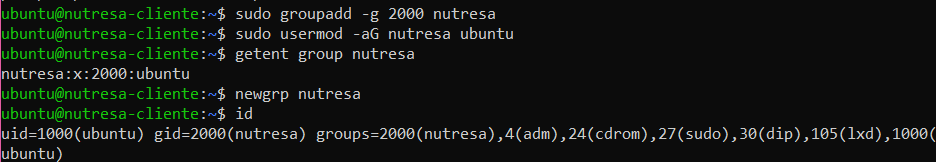

*Captura 14b — `capturas/14b_nfs_cliente_grupo_nutresa.png`: cliente: creación del grupo `nutresa` con GID 2000 y alta del usuario `ubuntu`.*


*Captura 14c — `capturas/14c_nfs_cliente_montaje.png`: cliente: creación del punto de montaje y montaje NFSv4 (`mount`, `df -hT`).*


*Captura 14d — `capturas/14d_nfs_cliente_prueba_escritura.png`: cliente: escritura y lectura de `prueba_cliente.txt` en `/mnt/nutresa`.*

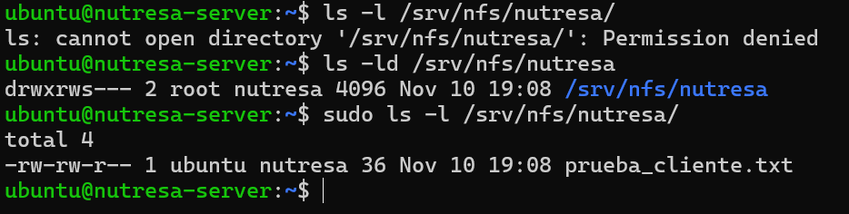

*Captura 14e — `capturas/14e_nfs_servidor_error_permisos.png`: servidor: `Permission denied` al listar el directorio (el usuario `ubuntu` no estaba en el grupo `nutresa`).*

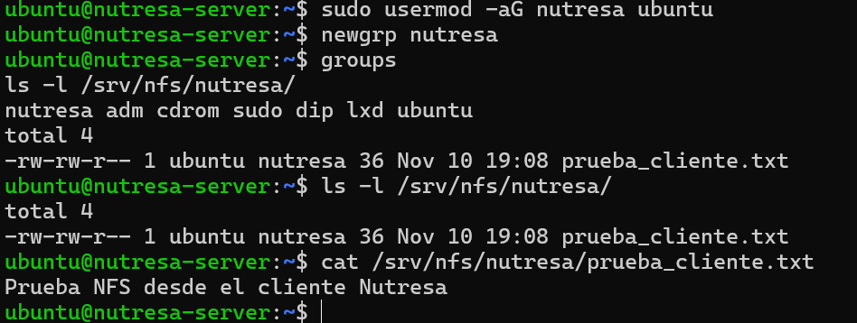

*Captura 14f — `capturas/14f_nfs_servidor_permisos_corregidos.png`: servidor: tras `usermod -aG nutresa ubuntu` y `newgrp nutresa` se lista el directorio y se lee el archivo.*

## 3.6 Montaje permanente en el cliente (`/etc/fstab`)

El montaje manual se pierde al reiniciar. Para hacerlo permanente:

```bash
sudo nano /etc/fstab
```

Se agrega al final:

```text
192.168.1.34:/ /mnt/nutresa nfs4 rw,_netdev,nofail,x-systemd.automount 0 0
```

| Opción | Función |
|---|---|
| `nfs4` | Tipo de sistema de archivos NFSv4 |
| `rw` | Lectura y escritura |
| `_netdev` | Indica que depende de la red (se monta después de levantar la red) |
| `nofail` | No impide el arranque si el servidor no está disponible |
| `x-systemd.automount` | Monta bajo demanda al acceder a la carpeta |

Aplicar y comprobar:

```bash
sudo systemctl daemon-reload
sudo mount -a
ls -la /mnt/nutresa
```

Se crea un archivo **desde el servidor** y se lee **desde el cliente**:

```bash
# En nutresa-server
echo "Documento creado desde el servidor Nutresa" | sudo tee /srv/nfs/nutresa/prueba_servidor.txt

# En nutresa-cliente
cat /mnt/nutresa/prueba_servidor.txt     # Documento creado desde el servidor Nutresa
```


*Captura 15a — `capturas/15a_nfs_fstab.png`: línea de montaje permanente en `/etc/fstab` del cliente.*


*Captura 15b — `capturas/15b_nfs_mount_a_verificacion.png`: `daemon-reload`, `mount -a` y listado de `/mnt/nutresa`.*


*Captura 15c — `capturas/15c_nfs_archivo_creado_en_servidor.png`: servidor: creación del archivo `prueba_servidor.txt`.*


*Captura 15d — `capturas/15d_nfs_cliente_lee_archivo.png`: cliente: lectura de `prueba_servidor.txt` creado desde el servidor.*

## 3.7 Lista de verificación de la Sección 3

| Verificación | Comando | Resultado esperado | Captura |
|---|---|---|---|
| Directorio y permisos | `ls -ld /srv/nfs/nutresa` | `drwxrws--- root nutresa` | 12 |
| Exportación activa | `sudo exportfs -v` | `192.168.1.0/24(rw,...,root_squash,...,fsid=0)` | 13 |
| Puerto NFS | `sudo ss -lntp \| grep 2049` | `LISTEN 0.0.0.0:2049` | 13 |
| Cliente ve el export | `showmount -e 192.168.1.34` | `/srv/nfs/nutresa 192.168.1.0/24` | — |
| Montaje NFSv4 | `mount \| grep nutresa` | `type nfs4 (... vers=4.2 ...)` | 14 |
| Escritura cliente → servidor | `cat /srv/nfs/nutresa/prueba_cliente.txt` | contenido enviado por el cliente | 14 |
| Escritura servidor → cliente | `cat /mnt/nutresa/prueba_servidor.txt` | contenido creado en el servidor | 15 |
| Montaje permanente | `sudo mount -a` sin errores | `/mnt/nutresa` montado | 15 |

## 3.8 Solución de problemas de la Sección 3

| # | Problema | Causa | Solución |
|---|---|---|---|
| 3.A | `exportfs: can't open /etc/exports for reading` en el estado del servicio recién instalado. | El archivo `/etc/exports` aún no existía. | Es normal; se creó el archivo (3.3) y se ejecutó `sudo exportfs -ra`. |
| 3.B | En el primer cliente: `mount.nfs4: Operation not permitted for 192.168.1.34:/`. Después: `mount point does not exist`. | El cliente estaba en la red NAT (`10.0.2.15`, ruta por `10.0.2.2`), fuera de `192.168.1.0/24`, que es la única subred autorizada en `/etc/exports`; luego faltaba crear el punto de montaje. | Conectar el cliente a `192.168.1.0/24` (`192.168.1.35`), ejecutar `sudo mkdir -p /mnt/nutresa` y repetir el `mount`. |
| 3.C | En el servidor: `ls: cannot open directory '/srv/nfs/nutresa/': Permission denied` aunque el archivo sí había llegado. | El directorio es `2770 root:nutresa` y el usuario `ubuntu` del servidor no pertenecía al grupo `nutresa`. | `sudo usermod -aG nutresa ubuntu` y `newgrp nutresa`; verificar con `groups` (Captura 14). Alternativa sin cambiar de grupo: `sudo ls -l /srv/nfs/nutresa/`. |
| 3.D | Los permisos no coinciden entre equipos. | NFS compara UID/GID numéricos. | Mantener el mismo grupo `nutresa` con GID `2000` en servidor y cliente (y, en la Sección 4, el usuario NIS `nisprueba` con GID `2000`). |

---

# Sección 4. Servicio NIS (autenticación centralizada)

**Objetivo.** Centralizar las cuentas de usuario Linux en `nutresa-server` mediante **NIS** (*Network Information Service*), de modo que un usuario creado una sola vez en el servidor sea reconocido por los clientes Linux de la red `192.168.1.0/24`.

**Decisiones de diseño:**

- `nutresa-server` es el **servidor maestro** (`NISSERVER=master`); no hay servidores esclavos.
- **Puertos fijos** para `ypserv` (`1011`) y `yppasswdd` (`1012`): por defecto NIS usa puertos dinámicos asignados por `rpcbind`, lo que impide filtrarlos con el firewall.
- **`securenets`** limita las consultas a `localhost` y a la subred `192.168.1.0/24`, porque NIS no cifra la información de las cuentas.
- El usuario de prueba `nisprueba` usa el **GID 2000** (`nutresa`), el mismo grupo de NFS (Sección 3), para que los permisos coincidan en ambos servicios.

| Parámetro | Valor |
|---|---|
| Servidor | `192.168.1.34` (`nutresa-server`) · paquetes `nis`, `ypserv`, `rpcbind` |
| Dominio NIS | `nutresa.local` |
| Puertos | `111` (rpcbind), `1011` (ypserv), `1012` (yppasswdd) · TCP/UDP |
| Usuario de prueba | `nisprueba` · UID `2101` · GID `2000` (`nutresa`) |
| Cliente | `nutresa-cliente` (`192.168.1.35`) |

## 4.1 Servidor: preparación e instalación de paquetes

Se confirma el nombre del servidor, su IP de servicio y que el grupo `nutresa` existe:

```bash
hostname
ip -br addr
getent group nutresa
```

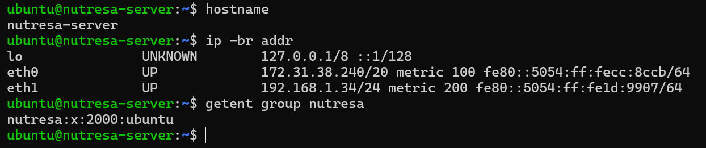

*Captura 18a — `capturas/18a_nis_preparacion_servidor.png`: nombre `nutresa-server`, IP `192.168.1.34` en `eth1` y grupo `nutresa:x:2000:ubuntu`.*

Se instalan los paquetes y se comprueba que quedaron con estado `ii` (instalado):

```bash
sudo apt update
sudo apt install -y nis
sudo apt install -y ypserv rpcbind
dpkg -l | grep -E 'nis|ypserv|yp-tools|rpcbind'
command -v ypserv
```

`ypinit` no está en el `PATH`: se invoca con la ruta completa `/usr/lib/yp/ypinit` (Problema 4.A).

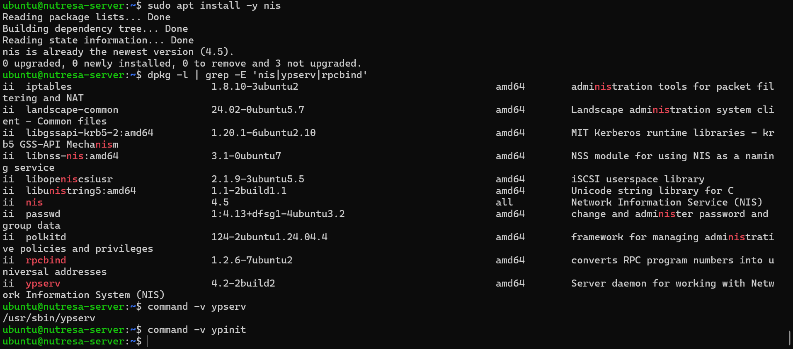

*Captura 18b — `capturas/18b_nis_paquetes_instalados.png`: `nis` 4.5, `rpcbind` y `ypserv` instalados; `command -v ypinit` no devuelve nada.*

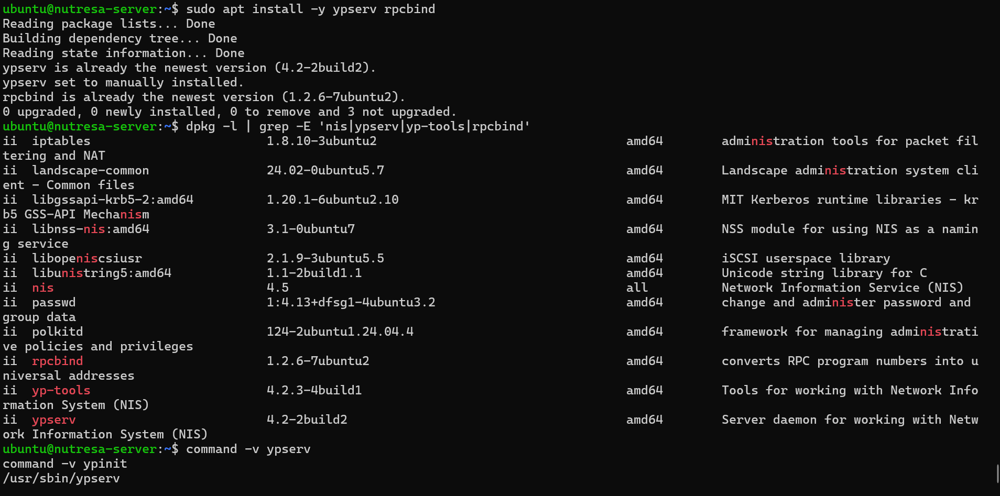

*Captura 18c — `capturas/18c_nis_ypserv_rpcbind.png`: instalación explícita de `ypserv` y `rpcbind`; `yp-tools` y `ypserv` con estado `ii`.*

## 4.2 Servidor: dominio NIS y nombre del equipo

```bash
echo "nutresa.local" | sudo tee /etc/defaultdomain
sudo domainname nutresa.local
domainname
```

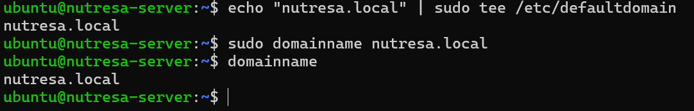

*Captura 18d — `capturas/18d_nis_dominio_nutresa_local.png`: dominio NIS `nutresa.local` guardado en `/etc/defaultdomain` y activo (`domainname`).*

Además, `ypinit` necesita que el nombre del servidor resuelva a su IP de red. En `/etc/hosts` solo existía `127.0.1.1 nutresa-server`, así que se agregó la IP de servicio (también en `/etc/cloud/templates/hosts.debian.tmpl`, porque cloud-init regenera `/etc/hosts` en cada arranque):

```text
192.168.1.34    nutresa-server
```

```bash
getent hosts nutresa-server     # 192.168.1.34    nutresa-server
```

## 4.3 Servidor: puertos fijos

```bash
sudo nano /etc/default/nis
```

Valores configurados:

```text
NISSERVER=master
NISCLIENT=false
YPSERVARGS="-p 1011"
YPPASSWDDARGS="--port 1012"
```

```bash
sudo systemctl restart ypserv yppasswdd
rpcinfo -p | grep -E 'ypserv|yppasswdd'
sudo ss -lntup | grep -E '1011|1012'
```

**Verificación.** `rpcinfo` muestra `ypserv` en `1011` y `yppasswdd` en `1012`, por TCP y UDP; `ss` confirma ambos puertos en escucha.

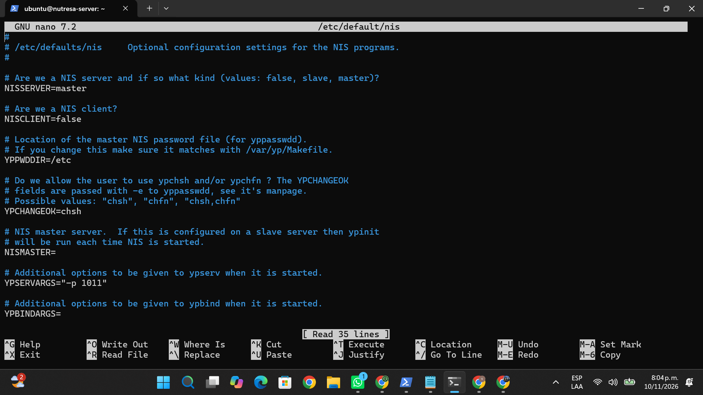

*Captura 18e — `capturas/18e_nis_default_nis_puertos.png`: `/etc/default/nis` con `NISSERVER=master`, `NISCLIENT=false` y `YPSERVARGS="-p 1011"`.*

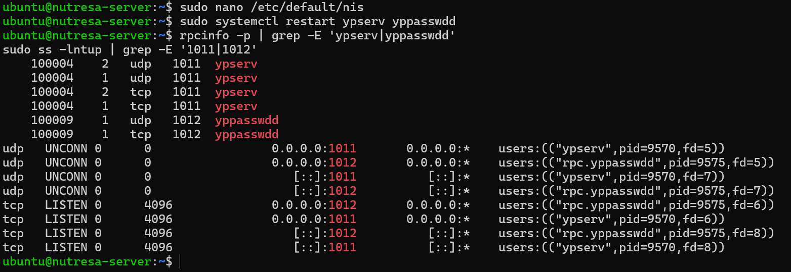

*Captura 18f — `capturas/18f_nis_puertos_1011_1012.png`: `ypserv` en el puerto `1011` y `yppasswdd` en el `1012` (`rpcinfo -p` y `ss -lntup`).*

## 4.4 Servidor: restringir el acceso a la red local

```bash
sudo nano /etc/ypserv.securenets
```

Se borran las dos líneas que dan acceso a todo el mundo (`0.0.0.0 0.0.0.0` y `::/0`) y queda:

```text
255.0.0.0       127.0.0.0
255.255.255.0   192.168.1.0
```

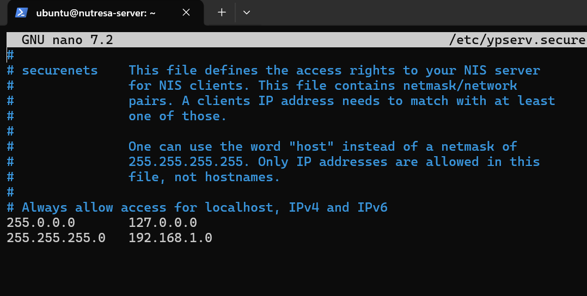

*Captura 18g — `capturas/18g_nis_securenets.png`: `/etc/ypserv.securenets` limitado a `localhost` y a la subred `192.168.1.0/24`.*

## 4.5 Servidor: usuario de prueba y base de datos NIS

Se crea un usuario exclusivo para probar NIS, en el grupo `nutresa`:

```bash
getent group 2000
sudo useradd -m -u 2101 -g 2000 -s /bin/bash nisprueba
sudo passwd nisprueba
id nisprueba        # uid=2101(nisprueba) gid=2000(nutresa) groups=2000(nutresa)
```

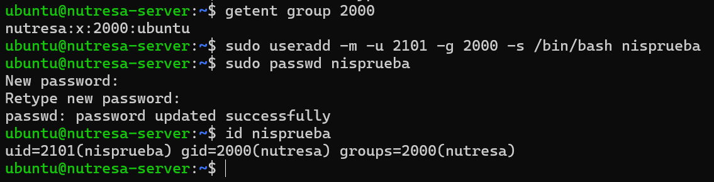

*Captura 18h — `capturas/18h_nis_usuario_nisprueba.png`: creación del usuario `nisprueba` (UID 2101, GID 2000).*

Se construyen los mapas NIS (`ypinit -m` pide la lista de servidores; se deja solo `nutresa-server` y se confirma con `Ctrl+D`):

```bash
sudo /usr/lib/yp/ypinit -m
sudo make -C /var/yp
ls -l /var/yp/nutresa.local/
```

Los mapas se generaron, pero `ypmatch` respondía `Internal NIS error` y `ypbind` no arrancaba en el propio servidor: `/etc/yp.conf` no tenía ninguna línea de servidor (Problema 4.C). Se corrigió así:

```bash
grep -v '^#' /etc/yp.conf          # vacío
echo "domain nutresa.local server 127.0.0.1" | sudo tee -a /etc/yp.conf
sudo systemctl restart ypbind
ypwhich                            # 127.0.0.1
sudo ypmatch nisprueba passwd.byname
ypcat passwd
```

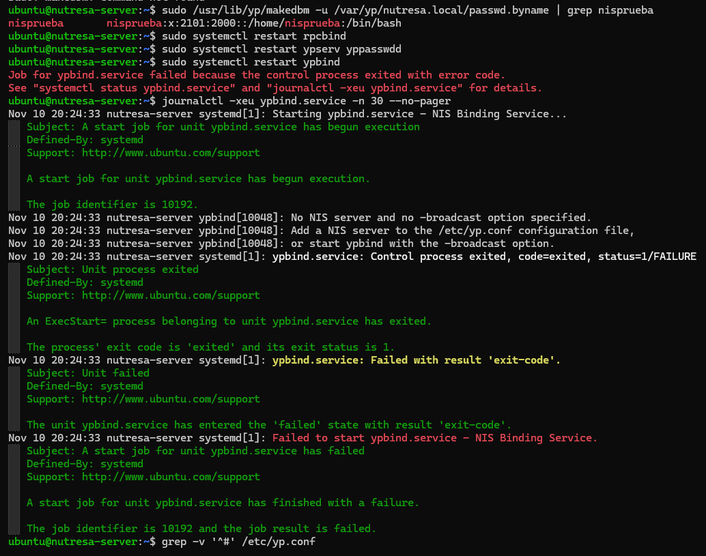

*Captura 18i — `capturas/18i_nis_error_ypbind.png`: el usuario sí está en el mapa (`makedbm -u`), pero `ypbind` falla con `No NIS server and no -broadcast option specified`.*

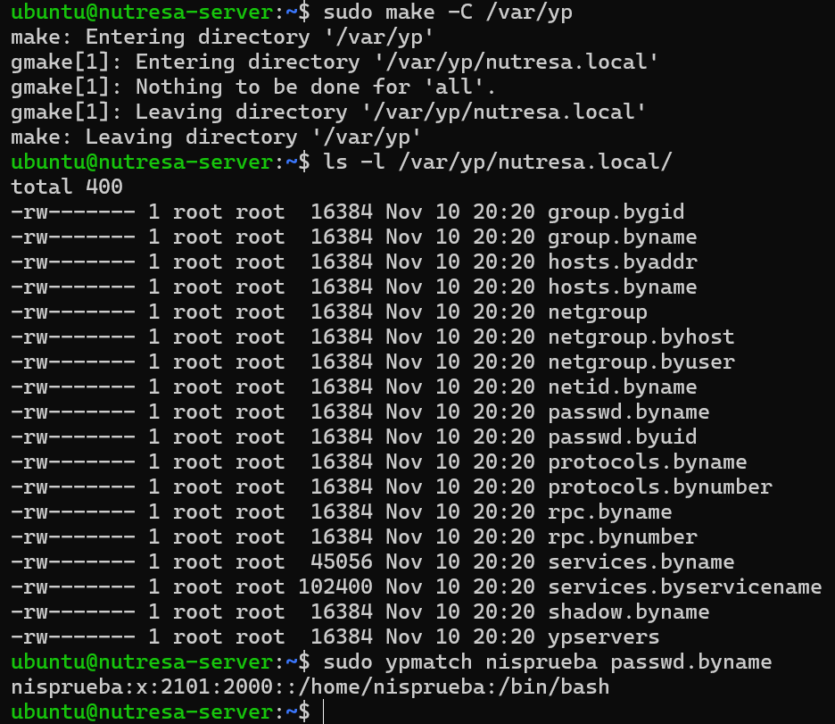

*Captura 18j — `capturas/18j_nis_mapas_ypmatch.png`: mapas en `/var/yp/nutresa.local/` (incluido `ypservers`) y `ypmatch nisprueba passwd.byname` devolviendo la cuenta.*

> **Importante.** Cada vez que se crea o modifica un usuario en el servidor hay que regenerar los mapas con `sudo make -C /var/yp`.

## 4.6 Servidor: activar los servicios y abrir los puertos

```bash
sudo systemctl enable rpcbind
sudo systemctl restart rpcbind
sudo systemctl restart ypserv
sudo systemctl status ypserv
sudo systemctl status rpcbind
sudo systemctl enable --now yppasswdd
```

**Verificación.** `ypserv` y `rpcbind` quedan `enabled` y `active (running)`; el proceso es `/usr/sbin/ypserv -p 1011`.

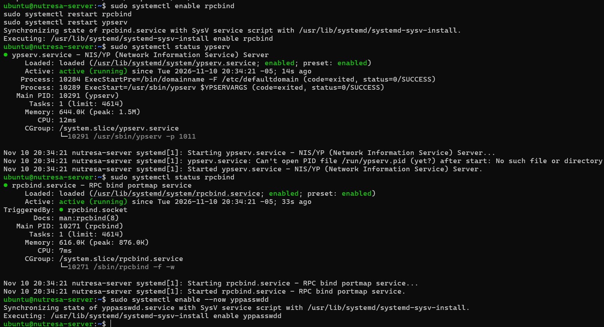

*Captura 18k — `capturas/18k_nis_servicios_activos.png`: `ypserv` (puerto 1011) y `rpcbind` activos y habilitados; `yppasswdd` habilitado.*

Reglas de firewall para la subred local:

```bash
sudo ufw allow from 192.168.1.0/24 to any port 111 proto tcp
sudo ufw allow from 192.168.1.0/24 to any port 111 proto udp
sudo ufw allow from 192.168.1.0/24 to any port 1011 proto tcp
sudo ufw allow from 192.168.1.0/24 to any port 1011 proto udp
sudo ufw allow from 192.168.1.0/24 to any port 1012 proto tcp
sudo ufw allow from 192.168.1.0/24 to any port 1012 proto udp
sudo ufw status
```

UFW está **inactivo** (`Status: inactive`): las reglas quedan registradas y se aplicarán al activarlo.

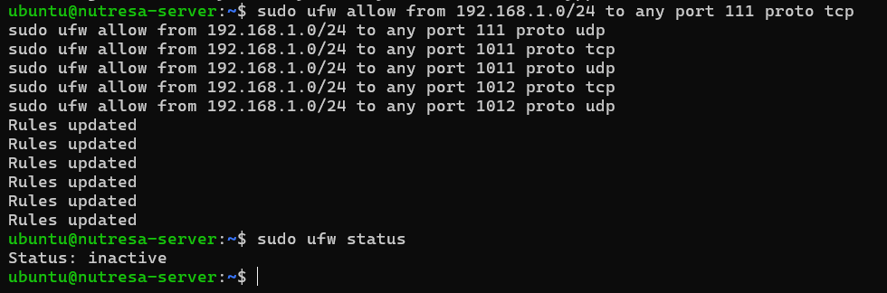

*Captura 18l — `capturas/18l_nis_ufw_puertos.png`: reglas de UFW para los puertos 111, 1011 y 1012 (TCP/UDP); UFW aún inactivo.*

## 4.7 Cliente: configuración NIS

En `nutresa-cliente`:

```bash
sudo apt update
sudo apt install -y nis rpcbind
sudo domainname nutresa.local
echo "nutresa.local" | sudo tee /etc/defaultdomain
echo "domain nutresa.local server 192.168.1.34" | sudo tee -a /etc/yp.conf
```

En `/etc/default/nis` del cliente se mantienen los valores por defecto del paquete (`NISSERVER=false`, `NISCLIENT=true`).

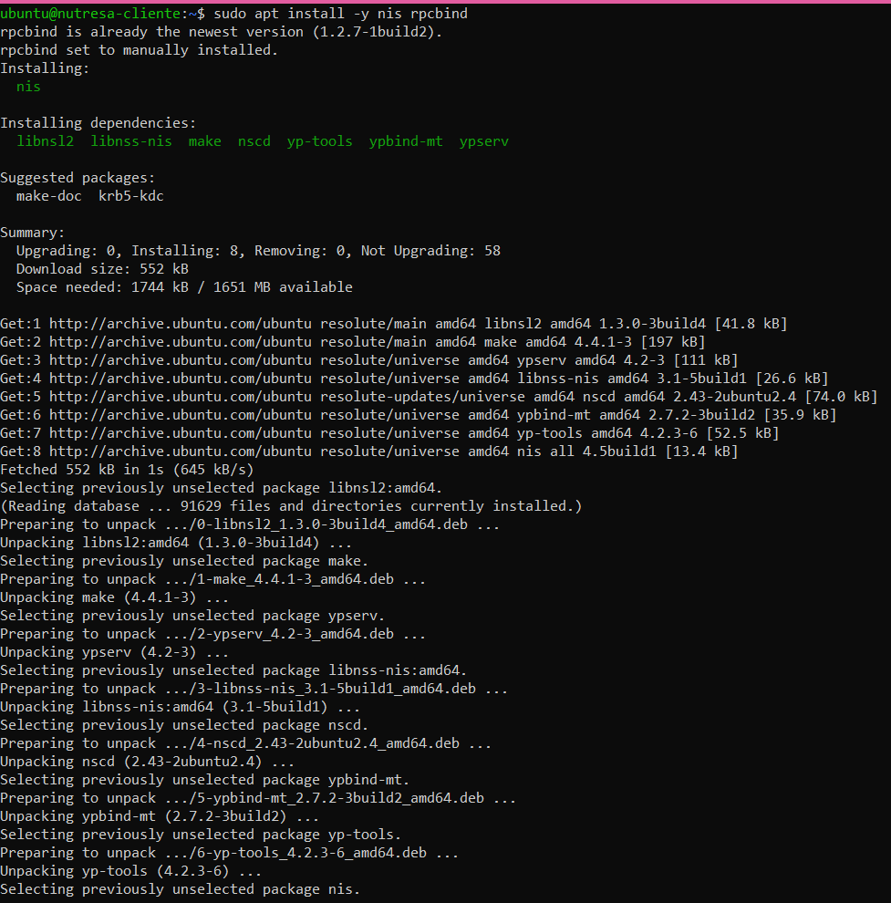

*Captura 19a — `capturas/19a_nis_cliente_instalar.png`: cliente: instalación de `nis` con sus dependencias (`ypbind-mt`, `yp-tools`, `libnss-nis`).*

Para que el sistema consulte las cuentas en NIS además de los archivos locales, se edita `/etc/nsswitch.conf` y se agrega `nis` a las bases de usuarios y grupos:

```bash
sudo nano /etc/nsswitch.conf
```

```text
passwd:         files systemd nis
group:          files systemd nis
```

Se activan los servicios:

```bash
sudo systemctl enable --now rpcbind ypbind
sudo systemctl restart ypbind
systemctl is-active ypbind
```

## 4.8 Cliente: verificación

```bash
ypwhich                               # 192.168.1.34
ypcat passwd
ypmatch nisprueba passwd.byname
getent passwd nisprueba               # nisprueba:x:2101:2000::/home/nisprueba:/bin/bash
getent group nutresa                  # nutresa:x:2000:ubuntu
```

**Verificación.** El cliente está enlazado al servidor `192.168.1.34` y resuelve el usuario `nisprueba` y el grupo `nutresa`, que **no existen localmente** en el cliente: los obtiene del servidor NIS.

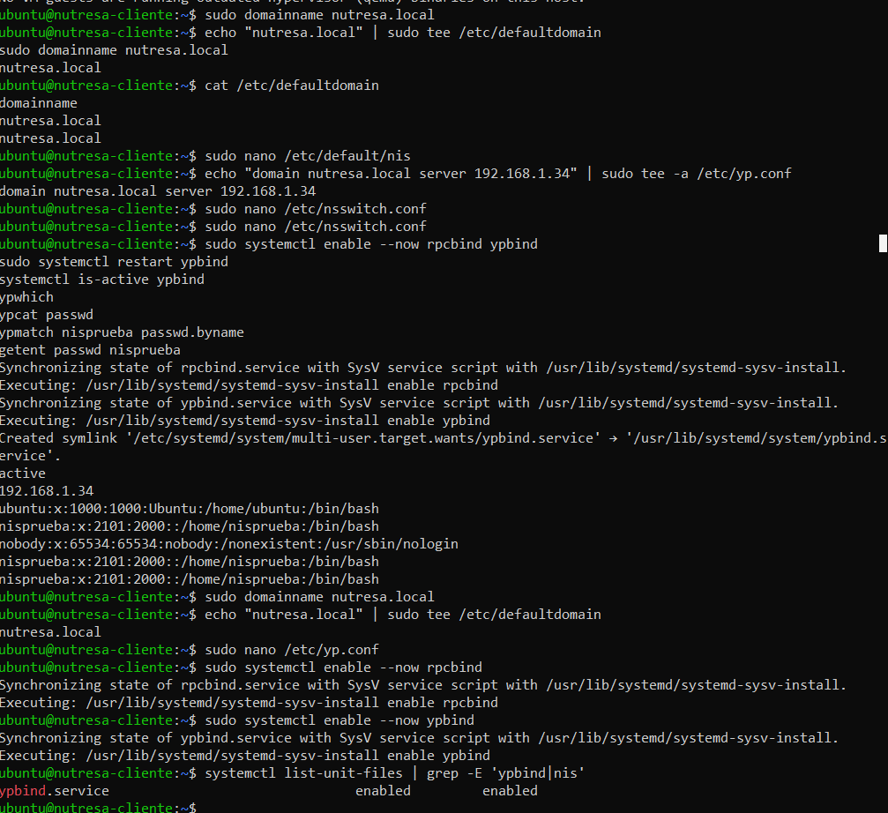

*Captura 19b — `capturas/19b_nis_cliente_configuracion.png`: cliente: dominio, `/etc/yp.conf`, activación de `ypbind`, `ypwhich` → `192.168.1.34` y `ypcat passwd` con el usuario `nisprueba`.*

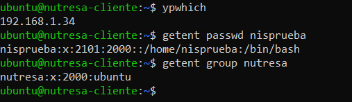

*Captura 19c — `capturas/19c_nis_cliente_verificacion.png`: cliente: `ypwhich`, `getent passwd nisprueba` y `getent group nutresa` resueltos por NIS.*

## 4.9 Lista de verificación de la Sección 4

| Verificación | Comando | Resultado esperado | Captura |
|---|---|---|---|
| Dominio NIS | `domainname` | `nutresa.local` | 18 |
| Puertos fijos | `rpcinfo -p \| grep yp` | `ypserv 1011`, `yppasswdd 1012` | 18 |
| Acceso restringido | `cat /etc/ypserv.securenets` | solo `127.0.0.0` y `192.168.1.0` | 18 |
| Usuario en el mapa | `sudo ypmatch nisprueba passwd.byname` | `nisprueba:x:2101:2000:...` | 18 |
| Servicios activos | `systemctl status ypserv rpcbind` | `active (running)` | 18 |
| Cliente enlazado | `ypwhich` (cliente) | `192.168.1.34` | 19 |
| Usuario visible en el cliente | `getent passwd nisprueba` (cliente) | `nisprueba:x:2101:2000:...` | 19 |

## 4.10 Solución de problemas de la Sección 4

| # | Problema | Causa | Solución |
|---|---|---|---|
| 4.A | `command -v ypinit` no devuelve nada. | `ypinit` no está en el `PATH`. | Ejecutarlo con la ruta completa: `sudo /usr/lib/yp/ypinit -m` (igual con `/usr/lib/yp/makedbm`). |
| 4.B | El primer `ypinit -m` mostró `failed to send 'clear' to local ypserv: RPC: Program not registered`, y `ypserv` usaba puertos dinámicos (`888`, `878`). | `ypserv` todavía no estaba en ejecución ni configurado con puertos fijos. | Fijar los puertos en `/etc/default/nis`, reiniciar `ypserv` y `yppasswdd`, y repetir `ypinit -m`. |
| 4.C | `ypmatch` respondía `Internal NIS error` y `ypbind` fallaba con `No NIS server and no -broadcast option specified`. | `/etc/yp.conf` del servidor no tenía ninguna línea de servidor (solo comentarios). | `echo "domain nutresa.local server 127.0.0.1" \| sudo tee -a /etc/yp.conf` y reiniciar `ypbind` (Capturas 18i y 18j). |
| 4.D | Un usuario nuevo no aparece en el cliente. | Los mapas NIS no se regeneran solos. | Ejecutar `sudo make -C /var/yp` en el servidor después de cada cambio de cuentas. |
---

# Sección 5. Servicio Samba (archivos compartidos para Windows y macOS)

**Objetivo.** Ofrecer una carpeta corporativa accesible desde clientes Windows y macOS mediante el protocolo **SMB**, solo para usuarios autenticados del grupo `sambausers`.

**Decisiones de diseño:**

- Servidor **independiente** (`server role = standalone server`), sin dominio de Active Directory.
- **Sin acceso de invitados**: `valid users = @sambausers`. Windows 11 además bloquea por defecto el acceso de invitados no autenticados.
- El usuario `sambanutresa` no tiene shell (`/usr/sbin/nologin`) ni directorio personal: solo sirve para acceder al recurso compartido.
- La carpeta usa `2770` con bit *setgid* y `force group = sambausers`, para que todo lo que se cree pertenezca al grupo.

| Parámetro | Valor |
|---|---|
| Servidor | `192.168.1.34` · Samba `4.19.5-Ubuntu` |
| Recurso compartido | `\\192.168.1.34\Corporativo` → `/srv/samba/corporativo` |
| Grupo | `sambausers` (GID 2001) |
| Usuario | `sambanutresa` (UID 2102) |
| Puertos | `445/tcp` (SMB); reglas también para `137-139` (NetBIOS) |
| Cliente | Windows 11 (`192.168.1.31`) |

## 5.1 Instalar Samba

```bash
sudo apt update
sudo apt install -y samba smbclient
smbd --version
sudo systemctl enable --now smbd
sudo systemctl status smbd
```

**Verificación.** `smbd --version` muestra `Version 4.19.5-Ubuntu`; el servicio está `enabled` y `active (running)` con el estado `smbd: ready to serve connections...`.

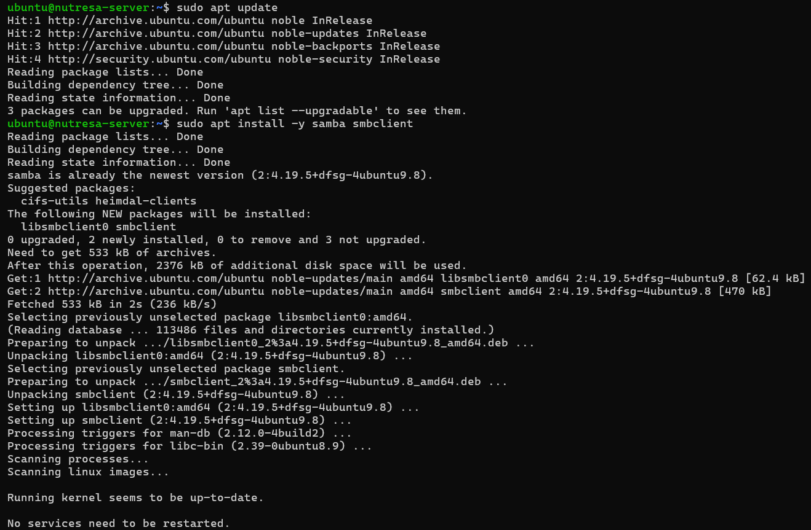

*Captura 20a — `capturas/20a_samba_instalar.png`: instalación de `samba` y `smbclient`.*

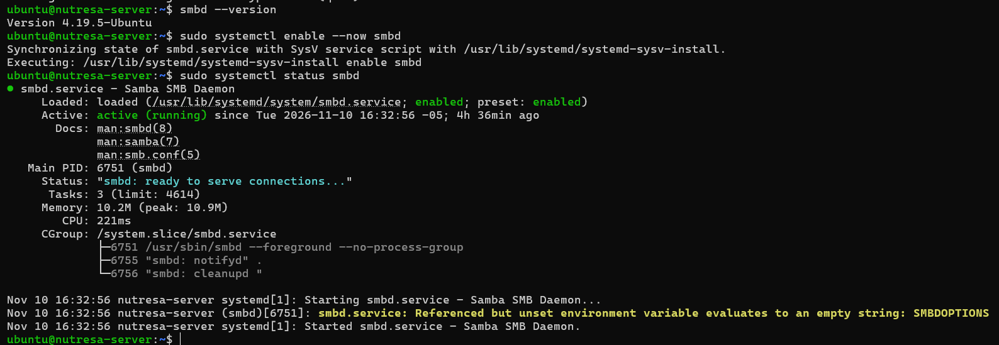

*Captura 20b — `capturas/20b_samba_servicio_activo.png`: versión de Samba y servicio `smbd` activo.*

## 5.2 Crear el grupo y el usuario Samba

```bash
sudo groupadd sambausers
sudo useradd -M -s /usr/sbin/nologin sambanutresa
sudo usermod -aG sambausers sambanutresa
sudo smbpasswd -a sambanutresa
sudo smbpasswd -e sambanutresa
sudo pdbedit -L                     # sambanutresa:2102:
```

Samba guarda sus propias contraseñas (`smbpasswd`), independientes de la contraseña Linux.

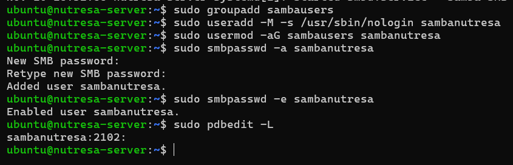

*Captura 20c — `capturas/20c_samba_usuario_grupo.png`: creación del grupo `sambausers`, del usuario `sambanutresa` y alta en la base de Samba (`pdbedit -L`).*

## 5.3 Crear la carpeta corporativa

```bash
sudo mkdir -p /srv/samba/corporativo
sudo chown root:sambausers /srv/samba/corporativo
sudo chmod 2770 /srv/samba/corporativo
ls -ld /srv/samba/corporativo       # drwxrws--- 2 root sambausers ...
echo "Documentacion corporativa Grupo Nutresa" | sudo tee /srv/samba/corporativo/README.txt
```

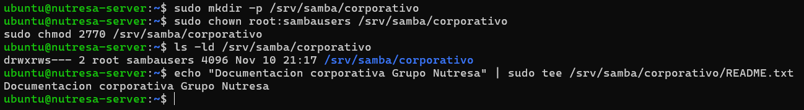

*Captura 20d — `capturas/20d_samba_carpeta_corporativo.png`: carpeta `/srv/samba/corporativo` con permisos `2770` y archivo de prueba `README.txt`.*

## 5.4 Configurar el recurso compartido

```bash
sudo nano /etc/samba/smb.conf
```

Se agrega al final:

```ini
[Corporativo]
   path = /srv/samba/corporativo
   browseable = yes
   read only = no
   guest ok = no
   valid users = @sambausers
   force group = sambausers
   create mask = 0660
   directory mask = 2770
```

| Opción | Función |
|---|---|
| `read only = no` | Permite escribir en el recurso |
| `guest ok = no` | No se permite el acceso de invitados |
| `valid users = @sambausers` | Solo los miembros del grupo `sambausers` pueden entrar |
| `force group = sambausers` | Todo archivo nuevo pertenece al grupo |
| `create mask = 0660` | Archivos nuevos: lectura y escritura para dueño y grupo |
| `directory mask = 2770` | Carpetas nuevas con *setgid* y sin acceso para otros |

Se valida la configuración, se reinicia el servicio y se abren los puertos:

```bash
testparm -s
sudo systemctl restart smbd nmbd
sudo ufw allow from 192.168.1.0/24 to any port 445 proto tcp
sudo ufw allow from 192.168.1.0/24 to any port 139 proto tcp
sudo ufw allow from 192.168.1.0/24 to any port 137 proto udp
sudo ufw allow from 192.168.1.0/24 to any port 138 proto udp
```

**Verificación.** `testparm -s` muestra `Loaded services file OK.`, `Server role: ROLE_STANDALONE` y el recurso `[Corporativo]` con las opciones anteriores. Prueba local:

```bash
smbclient //127.0.0.1/Corporativo -U sambanutresa -c 'ls'
```

Resultado: lista `README.txt` dentro del recurso.

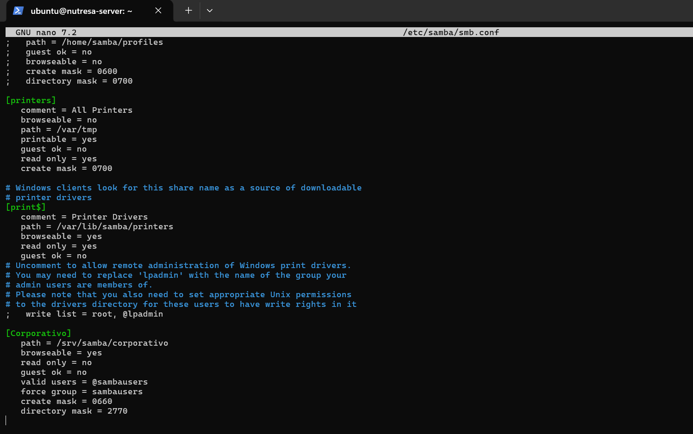

*Captura 20e — `capturas/20e_samba_smb_conf.png`: sección `[Corporativo]` al final de `/etc/samba/smb.conf`.*

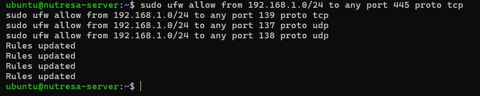

*Captura 20f — `capturas/20f_samba_ufw_puertos.png`: reglas de UFW para SMB (`445/tcp`) y NetBIOS (`137-139`).*

## 5.5 Prueba desde Windows

En el Explorador de archivos de Windows se escribe `\\192.168.1.34\Corporativo` en la barra de direcciones y se ingresan las credenciales de `sambanutresa`.

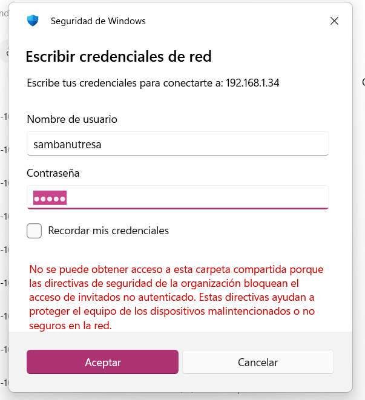

*Captura 21a — `capturas/21a_samba_windows_credenciales.png`: Windows pide credenciales de red para `192.168.1.34`; el aviso en rojo confirma que no se permite el acceso de invitados (Problema 5.A).*

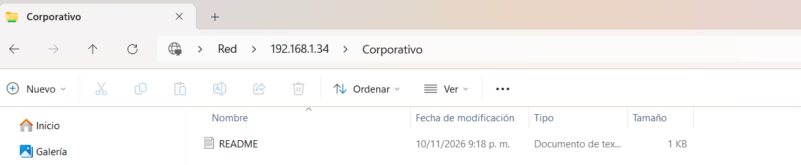

*Captura 21b — `capturas/21b_samba_windows_carpeta.png`: recurso `Corporativo` abierto desde Windows, con el archivo `README` creado en el servidor.*

Desde Windows se crea un archivo de texto de prueba dentro de la carpeta:

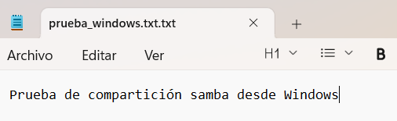

*Captura 21c — `capturas/21c_samba_windows_archivo_prueba.png`: archivo `prueba_windows.txt` creado desde Windows con el texto «Prueba de compartición samba desde Windows».*

Y se verifica desde el servidor:

```bash
sudo ls -l /srv/samba/corporativo/
```

```text
-rw-r--r-- 1 root         sambausers 40 Nov 10 21:18 README.txt
-rw-rw---- 1 sambanutresa sambausers 43 Nov 10 21:51 prueba_windows.txt.txt
```

El archivo llega con dueño `sambanutresa`, grupo `sambausers` y permisos `0660`, como se definió en `smb.conf`.

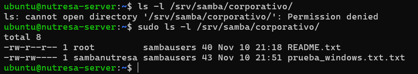

*Captura 21d — `capturas/21d_samba_servidor_verifica_archivo.png`: el archivo creado desde Windows aparece en el servidor con dueño `sambanutresa` y grupo `sambausers`.*

## 5.6 Lista de verificación de la Sección 5

| Verificación | Comando | Resultado esperado | Captura |
|---|---|---|---|
| Servicio activo | `systemctl status smbd` | `active (running)` | 20 |
| Usuario Samba | `sudo pdbedit -L` | `sambanutresa:2102:` | 20 |
| Permisos de la carpeta | `ls -ld /srv/samba/corporativo` | `drwxrws--- root sambausers` | 20 |
| Configuración válida | `testparm -s` | `Loaded services file OK.` y `[Corporativo]` | 20 |
| Acceso local | `smbclient //127.0.0.1/Corporativo -U sambanutresa -c 'ls'` | lista `README.txt` | — |
| Acceso desde Windows | `\\192.168.1.34\Corporativo` | carpeta abierta con credenciales | 21 |
| Escritura desde Windows | `sudo ls -l /srv/samba/corporativo/` | archivo de `sambanutresa` | 21 |

## 5.7 Solución de problemas de la Sección 5

| # | Problema | Causa | Solución |
|---|---|---|---|
| 5.A | Windows mostraba «No se puede obtener acceso a esta carpeta compartida porque las directivas de seguridad de la organización bloquean el acceso de invitados no autenticado». | Windows 11 intenta primero como invitado, y el recurso no lo permite (`guest ok = no`). | Ingresar el usuario `sambanutresa` y su contraseña de Samba en el cuadro de credenciales (Captura 21a). |
| 5.B | En el servidor, `ls -l /srv/samba/corporativo/` respondía `Permission denied`. | La carpeta es `2770 root:sambausers` y el usuario `ubuntu` no pertenece a `sambausers`. | Revisar con `sudo` (comportamiento esperado: solo el grupo tiene acceso). |
| 5.C | El archivo se llamaba `prueba_windows.txt.txt` y `cat prueba_windows.txt` no lo encontraba. | Windows oculta las extensiones conocidas y añadió `.txt` al nombre ya escrito con extensión. | Usar el nombre real que muestra `ls`, o activar «Extensiones de nombre de archivo» en el Explorador. |

---

# Sección 6. Servicio CUPS (servidor de impresión)

**Objetivo.** Centralizar la impresión en `nutresa-server` con **CUPS**, publicar una cola de impresión en la red local y administrarla desde el navegador.

**Decisiones de diseño:**

- Al no haber una impresora física, se usa una **impresora virtual PDF** (`cups-pdf`): cada trabajo se guarda como archivo PDF en el servidor, lo que permite probar la cola completa.
- El panel web y la administración se permiten solo desde `localhost` y la subred `192.168.1.0/24`.

| Parámetro | Valor |
|---|---|
| Servidor | `192.168.1.34` · CUPS `2.4.7` |
| Cola | `Nutresa-PDF` (backend `cups-pdf:/`) |
| Puerto | `631/tcp` (IPP y panel web) |
| Panel web | `http://192.168.1.34:631` |
| Salida de los trabajos | `~/PDF/` del usuario que imprime |

## 6.1 Instalar CUPS y la impresora virtual

```bash
sudo apt update
sudo apt install -y cups printer-driver-cups-pdf
sudo systemctl enable --now cups
sudo systemctl status cups
```

**Verificación.** `cups.service` queda `enabled` y `active (running)` con estado `Scheduler is running...`.

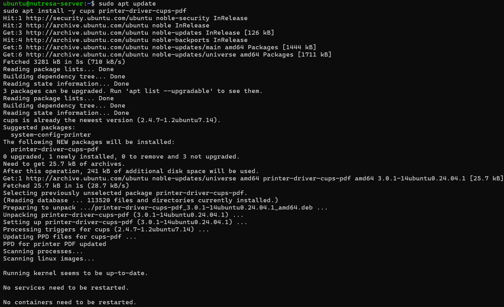

*Captura 22a — `capturas/22a_cups_instalar.png`: instalación de `cups` y `printer-driver-cups-pdf`.*

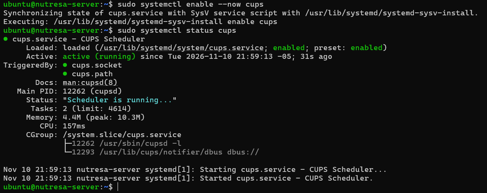

*Captura 22b — `capturas/22b_cups_servicio_activo.png`: servicio CUPS habilitado y en ejecución.*

## 6.2 Permitir el acceso desde la red local

Por defecto CUPS solo escucha en `localhost`. Se edita la configuración:

```bash
sudo nano /etc/cups/cupsd.conf
```

Cambios realizados:

```apache
# Escuchar en todas las interfaces (antes: Listen localhost:631)
Port 631
Listen /run/cups/cups.sock

<Location />
  Order allow,deny
  Allow localhost
  Allow 192.168.1.0/24
</Location>

<Location /admin>
  AuthType Default
  Require user @SYSTEM
  Order allow,deny
  Allow localhost
  Allow 192.168.1.0/24
</Location>
```

Se valida la sintaxis y se reinicia:

```bash
sudo cupsd -t
sudo systemctl restart cups
```

**Verificación.** `cupsd -t` responde `"/etc/cups/cupsd.conf" is OK.` (el aviso `Printer drivers are deprecated` es informativo y no impide el funcionamiento).

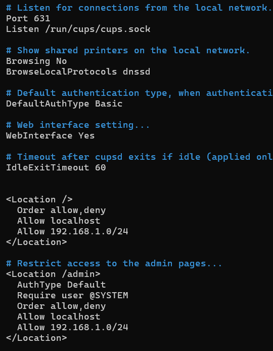

*Captura 22c — `capturas/22c_cups_cupsd_conf.png`: `cupsd.conf` con `Port 631` y acceso permitido a `192.168.1.0/24` en `/` y `/admin`.*

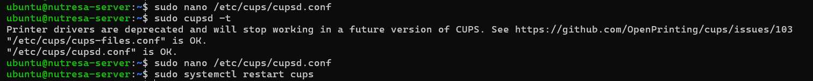

*Captura 22d — `capturas/22d_cups_validar_configuracion.png`: validación con `cupsd -t` y reinicio del servicio.*

## 6.3 Crear la cola de impresión `Nutresa-PDF`

```bash
lpinfo -m | grep -i pdf
sudo lpinfo -v | grep -i pdf        # file cups-pdf:/
sudo lpadmin -p Nutresa-PDF -E -v cups-pdf:/ -m drv:///sample.drv/generic.ppd
lpstat -p -d
sudo ufw allow from 192.168.1.0/24 to any port 631 proto tcp
```

| Opción de `lpadmin` | Función |
|---|---|
| `-p Nutresa-PDF` | Nombre de la cola |
| `-E` | Habilita la impresora y acepta trabajos |
| `-v cups-pdf:/` | Dispositivo: la impresora virtual PDF |
| `-m drv:///sample.drv/generic.ppd` | Controlador genérico PostScript |

**Verificación.** `lpstat -p -d` muestra `printer Nutresa-PDF is idle. enabled since ...`. El paquete `cups-pdf` crea además su propia cola `PDF`, que queda como destino por defecto.

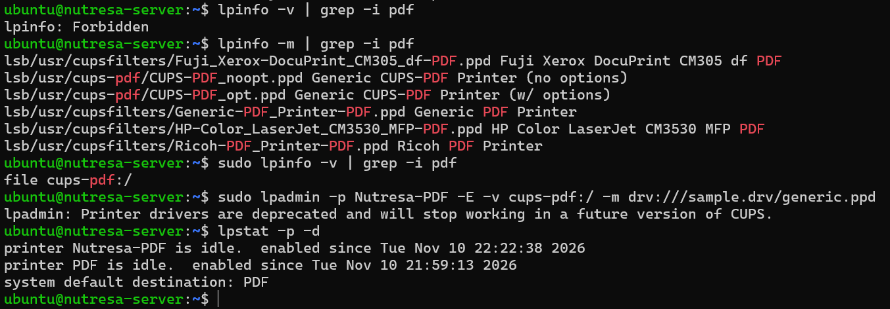

*Captura 22e — `capturas/22e_cups_impresora_nutresa_pdf.png`: dispositivo `cups-pdf:/`, creación de la cola `Nutresa-PDF` y estado con `lpstat -p -d`.*

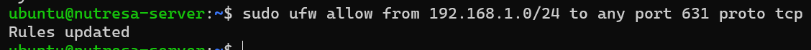

*Captura 22f — `capturas/22f_cups_ufw_631.png`: regla de UFW para el puerto `631/tcp` (UFW aún inactivo; la regla queda registrada).*

## 6.4 Prueba de impresión

```bash
echo "Prueba de impresion centralizada - Grupo Nutresa" > ~/prueba_impresion.txt
lp -d Nutresa-PDF ~/prueba_impresion.txt       # request id is Nutresa-PDF-1
lpstat -o                                      # cola vacía: el trabajo ya terminó
lpstat -W completed                            # Nutresa-PDF-1  ubuntu  1024  ...
ls -l ~/PDF/                                   # prueba_impresion.pdf
```

**Verificación.** El trabajo `Nutresa-PDF-1` aparece como completado y el PDF generado (`prueba_impresion.pdf`, 8474 bytes) está en `~/PDF/`.

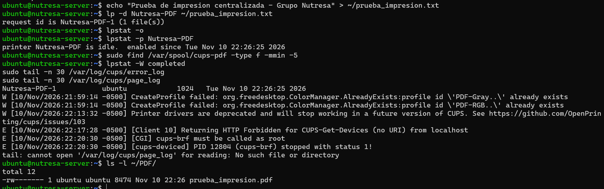

*Captura 22g — `capturas/22g_cups_prueba_impresion.png`: envío del trabajo con `lp`, trabajo completado en `lpstat -W completed` y PDF generado en `~/PDF/`.*

## 6.5 Panel web desde Windows

Desde el navegador de Windows se abre `http://192.168.1.34:631/printers/`:

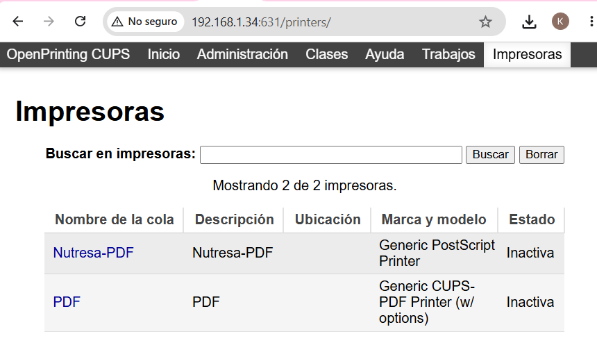

*Captura 22h — `capturas/22h_cups_panel_windows.png`: panel de CUPS desde Windows con las colas `Nutresa-PDF` y `PDF`. El estado «Inactiva» equivale a `idle`: la impresora está lista y sin trabajos en cola.*

## 6.6 Lista de verificación de la Sección 6

| Verificación | Comando | Resultado esperado | Captura |
|---|---|---|---|
| Servicio activo | `systemctl status cups` | `active (running)` | 22 |
| Configuración válida | `sudo cupsd -t` | `cupsd.conf is OK` | 22 |
| Cola creada | `lpstat -p Nutresa-PDF` | `printer Nutresa-PDF is idle. enabled` | 22 |
| Trabajo procesado | `lpstat -W completed` | `Nutresa-PDF-1 ... ubuntu` | 22 |
| PDF generado | `ls -l ~/PDF/` | `prueba_impresion.pdf` | 22 |
| Panel desde la red | `http://192.168.1.34:631/printers/` | lista de impresoras | 22 |

## 6.7 Solución de problemas de la Sección 6

| # | Problema | Causa | Solución |
|---|---|---|---|
| 6.A | `lpinfo -v` respondía `lpinfo: Forbidden`. | Listar dispositivos requiere privilegios de administración de CUPS. | Ejecutarlo con `sudo` (Captura 22e). |
| 6.B | El PDF no aparecía en `/var/spool/cups-pdf`. | `cups-pdf` guarda los archivos en el directorio `~/PDF/` del usuario que imprime. | Buscar en `~/PDF/` (Captura 22g). |
| 6.C | Aviso `Printer drivers are deprecated and will stop working in a future version of CUPS`. | CUPS 2.4 anuncia el fin de los controladores PPD clásicos. | Es solo una advertencia; la cola funciona. A futuro, usar impresoras IPP Everywhere sin controlador. |
| 6.D | El log mostraba `cups-brf must be called as root` y `CreateProfile failed ... already exists`. | Errores de módulos no usados (impresora braille) y del gestor de color al recrear perfiles. | No afectan la cola `Nutresa-PDF`; se pueden ignorar. |

---

# Sección 7. Traefik, dominio y SSL/TLS

> **Requisito previo:** Dokploy ya instalado en el servidor (ver la Sección 8.1); Traefik se instala junto con Dokploy.

**Objetivo.** Dejar el servidor `nutresa-server` accesible por un nombre de dominio real (`nutresa-admin.duckdns.org`) y con un certificado HTTPS válido de Let's Encrypt, usando el desafío **DNS-01** de ACME, que no requiere abrir puertos del router (la red es local, detrás del Wi-Fi).

**Resumen de lo realizado**

1. Apuntar el dominio de DuckDNS a la IP de servicio `192.168.1.34`.
2. Verificar la resolución DNS del dominio desde Windows y desde la VM.
3. Configurar Traefik con el proveedor `duckdns` y el desafío DNS-01 (primero con el servidor *staging* de Let's Encrypt).
4. Recrear el contenedor de Traefik con el token de DuckDNS.
5. Configurar el dominio en Dokploy.
6. Pasar del certificado de pruebas al certificado real de producción.
7. Probar el acceso HTTPS desde Windows y desde el navegador.

## 7.1 Dominio DNS con DuckDNS

### Apuntar el dominio a la IP privada

En el panel oficial de [DuckDNS](https://www.duckdns.org) se agrega un nuevo dominio, en este caso `nutresa-admin`, se escribe la IP `192.168.1.34` y se pulsa *update ip*. DuckDNS genera un token que, por razones de seguridad, no se comparte con nadie.


*Captura 16a — `capturas/16a_duckdns_panel.png`: panel de DuckDNS con el dominio `nutresa-admin` y la IP `192.168.1.34`.*

### Probar la resolución del dominio

Se prueba desde la terminal de Windows para confirmar que el dominio responde con la IP correcta:

```powershell
nslookup nutresa-admin.duckdns.org 8.8.8.8
nslookup nutresa-admin.duckdns.org
```


*Captura 16b — `capturas/16b_nslookup_dns_8888.png`: `nslookup` contra `8.8.8.8` devolviendo `192.168.1.34`.*


*Captura 16c — `capturas/16c_nslookup_dns_default.png`: `nslookup` con el DNS predeterminado del sistema.*

Desde Ubuntu (`nutresa-server`) también se prueba:

```bash
getent hosts nutresa-admin.duckdns.org
```


*Captura 16d — `capturas/16d_getent_hosts_vm.png`: resolución del dominio desde la VM.*

Con esto queda creado el dominio DNS.

## 7.2 Certificado SSL/TLS con Let's Encrypt (DNS-01)

Con el desafío **DNS-01**, Let's Encrypt no se conecta al servidor directamente: solo consulta un registro TXT que Traefik crea en DuckDNS con el token. Así no es necesario abrir puertos ni tocar el router.

### Revisar la configuración actual de Traefik

En el shell de `nutresa-server` se verifica cómo está Traefik y cuáles son los montajes del contenedor:

```bash
sudo docker exec dokploy-traefik traefik version
sudo docker inspect dokploy-traefik --format '{{json .Mounts}}'
sudo cat /etc/dokploy/traefik/traefik.yml
sudo ls -l /etc/dokploy/traefik/dynamic/
```

Hallazgos: el resolver `letsencrypt` usaba el desafío **HTTP-01**, que necesita el puerto 80 abierto a internet y no funciona en una red local; además, el archivo `acme.json` tenía 0 bytes, es decir, nunca se había emitido un certificado.

### Copia de seguridad

Antes de proceder se guarda una copia de seguridad de la configuración por si algo falla:

```bash
sudo mkdir -p /root/backup-red
sudo cp -a /etc/dokploy/traefik/traefik.yml /root/backup-red/traefik.yml.bak
sudo ls -l /root/backup-red
```


*Captura 17a — `capturas/17a_traefik_backup.png`: copia de seguridad de `traefik.yml` creada en `/root/backup-red`.*

### Guardar el token de forma segura

El token se guarda en un archivo que solo puede leer root, fuera del repositorio:

```bash
read -rsp "DUCKDNS_TOKEN: " T; echo
printf 'DUCKDNS_TOKEN=%s\n' "$T" | sudo tee /root/duckdns.env >/dev/null
sudo chmod 600 /root/duckdns.env
```


*Captura 17b — `capturas/17b_token_duckdns_env.png`: guardado del token de DuckDNS en `/root/duckdns.env`.*

El token no se guardó correctamente en el primer intento (el archivo quedó vacío); se resolvió escribiéndolo con `nano` (ver Problema 7.B):

```bash
sudo nano /root/duckdns.env
sudo chmod 600 /root/duckdns.env
sudo awk -F= '/^DUCKDNS_TOKEN=/{print "longitud en archivo:", length($2)}' /root/duckdns.env
```


*Captura 17c — `capturas/17c_token_correccion_nano.png`: corrección del token con `nano` y verificación de su longitud.*

### Editar `traefik.yml` (primero con staging)

Se cambia `httpChallenge` por `dnsChallenge` con el proveedor `duckdns`, se pone un correo real y, para probar sin gastar los límites de Let's Encrypt, se usa el servidor de pruebas (*staging*):

```bash
sudo nano /etc/dokploy/traefik/traefik.yml
```

El contenido queda así:

```yaml
global:
  sendAnonymousUsage: false
providers:
  swarm:
    exposedByDefault: false
    watch: true
  docker:
    exposedByDefault: false
    watch: true
    network: dokploy-network
  file:
    directory: /etc/dokploy/traefik/dynamic
    watch: true
entryPoints:
  web:
    address: :80
  websecure:
    address: :443
    http3:
      advertisedPort: 443
    http:
      tls:
        certResolver: letsencrypt
api:
  insecure: true
certificatesResolvers:
  letsencrypt:
    acme:
      email: <correo-del-equipo>
      storage: /etc/dokploy/traefik/dynamic/acme.json
      caServer: https://acme-staging-v02.api.letsencrypt.org/directory
      dnsChallenge:
        provider: duckdns
        resolvers:
          - "1.1.1.1:53"
          - "8.8.8.8:53"
```


*Captura 17d — `capturas/17d_traefik_yml_dnschallenge.png`: edición de `traefik.yml` con `dnsChallenge` y servidor *staging*.*

Se valida el archivo:

```bash
sudo python3 -c 'import yaml; yaml.safe_load(open("/etc/dokploy/traefik/traefik.yml")); print("YAML OK")'
```


*Captura 17e — `capturas/17e_traefik_yml_yaml_ok.png`: validación del YAML modificado.*

Traefik se reiniciaba en bucle y los sitios quedaban sin servicio por dos errores de escritura en el YAML; se corrigieron y el servicio volvió a la normalidad (ver Problemas 7.C y 7.D):

```bash
sudo sed -i 's/insercure/insecure/' /etc/dokploy/traefik/traefik.yml
sudo grep -n -B1 -A1 'insecure' /etc/dokploy/traefik/traefik.yml
sudo python3 -c 'import yaml; yaml.safe_load(open("/etc/dokploy/traefik/traefik.yml")); print("YAML OK")'
sudo docker restart dokploy-traefik
sleep 5
```


*Captura 17f — `capturas/17f_traefik_fix_insecure.png`: corrección del primer error de escritura (`insercure` → `insecure`).*

```bash
sudo sed -i 's/exposeByDefault/exposedByDefault/' /etc/dokploy/traefik/traefik.yml
sudo grep -n 'exposedByDefault' /etc/dokploy/traefik/traefik.yml
sudo python3 -c 'import yaml; yaml.safe_load(open("/etc/dokploy/traefik/traefik.yml")); print("YAML OK")'
sudo docker restart dokploy-traefik
sudo docker logs --since 1m dokploy-traefik
sudo docker ps --format 'table {{.Names}}\t{{.Status}}\t{{.Ports}}' | grep traefik
```


*Captura 17g — `capturas/17g_traefik_fix_exposedbydefault.png`: corrección del segundo error de escritura (`exposeByDefault` → `exposedByDefault`).*

### Recrear Traefik con el token

La variable `DUCKDNS_TOKEN` debe existir dentro del contenedor, y un `docker restart` no añade variables de entorno. Por eso se recreó el contenedor con las mismas opciones que tenía, más `--env-file`. Solo se elimina el contenedor: los datos persisten en carpetas del servidor.

```bash
sudo docker rm -f dokploy-traefik
sudo docker run -d \
  --name dokploy-traefik \
  --restart always \
  --network dokploy-network \
  --env-file /root/duckdns.env \
  -v /etc/dokploy/traefik/traefik.yml:/etc/traefik/traefik.yml \
  -v /etc/dokploy/traefik/dynamic:/etc/dokploy/traefik/dynamic \
  -v /var/run/docker.sock:/var/run/docker.sock:ro \
  -p 80:80/tcp -p 443:443/tcp -p 443:443/udp \
  traefik:v3.6.25
```


*Captura 17h — `capturas/17h_traefik_contenedor_recreado.png`: recreación del contenedor de Traefik con `--env-file`.*

Se comprueba que el token llegó al contenedor y se revisan los logs:

```bash
sudo docker exec dokploy-traefik printenv DUCKDNS_TOKEN | wc -c
sudo docker logs -f --since 1m dokploy-traefik 2>&1 | grep -iE 'acme|duckdns|certificate|error|unable'
```


*Captura 17i — `capturas/17i_traefik_token_en_contenedor.png`: contenedor `dokploy-traefik` en ejecución con el token disponible.*

En los logs aparecía que no se podía obtener el certificado de ACME y que el certificado servido era `TRAEFIK DEFAULT CERT` (el de respaldo): Traefik reconocía el proveedor `duckdns`, pero por el token vacío no lo estaba leyendo bien (ver Problema 7.D).


*Captura 17j — `capturas/17j_traefik_logs_error_acme.png`: logs de error del certificado antes de corregir el token.*

### Configurar el dominio en Dokploy

En el panel de Dokploy: proyecto → aplicación web `nutresa` → pestaña **Domains**, con estos valores:

| Campo | Valor |
|---|---|
| Host | `nutresa-admin.duckdns.org` |
| Path | `/` |
| Container Port | `80` |
| HTTPS | Activado |
| Certificate | Let's Encrypt |


*Captura 17k — `capturas/17k_dokploy_dominio_https.png`: dominio configurado en Dokploy con HTTPS y certificado Let's Encrypt.*

Dokploy genera la ruta de Traefik en `/etc/dokploy/traefik/dynamic/my-first-project-nutresa-qmjfti.yml`, con un router `web` que redirige a HTTPS y un router `websecure` que usa `certResolver: letsencrypt`:

```bash
sudo cat /etc/dokploy/traefik/dynamic/my-first-project-nutresa-qmjfti.yml
```

### Verificar el resultado de la prueba (staging)

```bash
sudo docker logs --since 2m dokploy-traefik 2>&1 | grep -iE 'acme|duckdns|certificate|error|unable'
echo | openssl s_client -connect 192.168.1.34:443 -servername nutresa-admin.duckdns.org 2>/dev/null | openssl x509 -noout -issuer -subject -dates
```


*Captura 17l — `capturas/17l_certificado_staging.png`: certificado de staging, issuer = (STAGING) Dastardly Durum YR1. La prueba DNS-01 funcionó correctamente.*

### Pasar al certificado real en producción

Se eliminó el `caServer` de `traefik.yml` y se vació `acme.json`, que solo contenía certificados de prueba. Traefik se detuvo solo unos segundos; `docker start` conserva la variable del token.

```bash
sudo nano /etc/dokploy/traefik/traefik.yml
sudo python3 -c 'import yaml; yaml.safe_load(open("/etc/dokploy/traefik/traefik.yml")); print("YAML OK")'
sudo docker stop dokploy-traefik
sudo truncate -s 0 /etc/dokploy/traefik/dynamic/acme.json
sudo chmod 600 /etc/dokploy/traefik/dynamic/acme.json
sudo docker start dokploy-traefik
sleep 60
echo | openssl s_client -connect 192.168.1.34:443 -servername nutresa-admin.duckdns.org 2>/dev/null | openssl x509 -noout -issuer -subject -dates
```


*Captura 17m — `capturas/17m_certificado_produccion.png`: certificado de producción, issuer = Let's Encrypt, CN = YR2.*

Con esto se genera el certificado real de Let's Encrypt para `nutresa-admin.duckdns.org`, válido del 12 de noviembre de 2026 al 10 de febrero de 2027. Traefik lo renueva automáticamente unos 30 días antes de vencer.

### Probar el acceso desde Windows

Para comprobar que el certificado funciona se prueba el acceso a la página desde la terminal de Windows:

```powershell
Test-NetConnection nutresa-admin.duckdns.org -Port 443
curl.exe -I https://nutresa-admin.duckdns.org
curl.exe -I http://nutresa-admin.duckdns.org
```


*Captura 17n — `capturas/17n_windows_prueba_https.png`: verificación de conexión con `200 OK` por HTTPS y `308` (redirección) por HTTP.*

Luego, en el navegador, se accede a la página:


*Captura 17o — `capturas/17o_navegador_https.png`: acceso desde el navegador para verificar el HTTPS.*

El navegador mostraba inicialmente el sitio como «no seguro», pero era por la caché del navegador (ver Problema 7.E): al abrirlo en una ventana de incógnito se confirmó que el certificado servía.


*Captura 17p — `capturas/17p_navegador_sitio_seguro.png`: verificación de sitio seguro en el navegador.*

## 7.3 Lista de verificación de la Sección 7

| Verificación | Comando | Resultado esperado | Captura |
|---|---|---|---|
| Dominio apunta a la IP de servicio | `nslookup nutresa-admin.duckdns.org` | `192.168.1.34` | 16 |
| Resolución desde la VM | `getent hosts nutresa-admin.duckdns.org` | `192.168.1.34` | 16 |
| Copia de seguridad de Traefik | `sudo ls -l /root/backup-red` | `traefik.yml.bak` presente | 17 |
| Token protegido | `sudo ls -l /root/duckdns.env` | permisos `-rw------- (600)` | 17 |
| YAML válido | `python3 -c 'yaml.safe_load(...)'` | `YAML OK` | 17 |
| Token dentro del contenedor | `docker exec dokploy-traefik printenv DUCKDNS_TOKEN` | imprime el token | 17 |
| Certificado de producción | `openssl s_client ... \| openssl x509 -noout -issuer` | issuer = Let's Encrypt (producción) | 17 |
| HTTPS desde Windows | `curl.exe -I https://nutresa-admin.duckdns.org` | `HTTP/... 200 OK` | 17 |

## 7.4 Solución de problemas de la Sección 7

| # | Problema | Causa | Solución |
|---|---|---|---|
| 7.A | El resolver `letsencrypt` no podía emitir certificados: usaba el desafío HTTP-01. | HTTP-01 necesita el puerto 80 abierto a internet y no funciona en una red local. | Cambiar a `dnsChallenge` con el proveedor `duckdns` en `traefik.yml` (Sección 7.2). |
| 7.B | El token de DuckDNS no se guardó: `/root/duckdns.env` quedó vacío. | El guardado interactivo con `read`/`printf` falló. | Escribir el token con `sudo nano /root/duckdns.env`, `chmod 600` y verificar la longitud con `awk` (Captura 17c). |
| 7.C | Traefik se reiniciaba en bucle y los sitios quedaban sin servicio. | Dos errores de escritura en `traefik.yml`: `insercure` en lugar de `insecure` y `exposeByDefault` en lugar de `exposedByDefault`. | Corregir ambos con `sed`, validar el YAML y reiniciar el contenedor (Capturas 17f y 17g). |
| 7.D | Los logs mostraban fallo de ACME y el certificado servido era `TRAEFIK DEFAULT CERT` (el de respaldo). | Traefik reconocía el proveedor `duckdns`, pero leía el token vacío del Problema 7.B. | Corregir el token (7.B) y recrear el contenedor con `--env-file` (Captura 17j). |
| 7.E | El navegador mostraba el sitio como «no seguro» con el certificado real ya emitido. | Caché del navegador con el certificado anterior. | Verificar en una ventana de incógnito; el candado apareció correctamente (Captura 17p). |

---

# Sección 8. Dokploy y PostgreSQL

**Objetivo.** Instalar **Dokploy** como plataforma PaaS en `nutresa-server` para desplegar el sitio web, la API y la base de datos en contenedores, y crear la base de datos **PostgreSQL** de la aplicación.

**Componentes que instala Dokploy:**

| Componente | Imagen | Función |
|---|---|---|
| Docker Engine + Swarm | `docker-ce 28.5.0` | Ejecuta los contenedores; Dokploy inicia un clúster Swarm de un solo nodo |
| `dokploy` | `dokploy/dokploy:v0.31.0` | Panel web en el puerto `3000` |
| `dokploy-postgres` | `postgres:16` | Base de datos interna del propio Dokploy |
| `dokploy-traefik` | `traefik:v3.6.25` | Proxy inverso en `80` y `443` (configurado en la Sección 7) |

## 8.1 Instalar Dokploy

Se comprueban los recursos de la VM y que los puertos que usará Dokploy estén libres:

```bash
free -h            # 3.8 GiB de RAM
df -h /            # 38 GB de disco, 7 % usado
nproc              # 2
sudo ss -lntp | grep -E ':80 |:443 |:3000 '     # sin salida: puertos libres
```


*Captura 23a — `capturas/23a_dokploy_recursos_vm.png`: la VM cumple los mínimos del proyecto (2 vCPU, ≈4 GB de RAM, ≈40 GB de disco).*


*Captura 23b — `capturas/23b_dokploy_puertos_libres.png`: ningún proceso usa los puertos 80, 443 ni 3000.*

Se instala Dokploy indicando la IP de servicio. `ADVERTISE_ADDR` es necesario porque la VM tiene dos interfaces (`eth0` interna y `eth1` en la red local) y Docker Swarm debe anunciarse en la de la red local:

```bash
sudo apt update
sudo apt install -y curl
curl -sSL https://dokploy.com/install.sh | sudo ADVERTISE_ADDR=192.168.1.34 sh
```


*Captura 23c — `capturas/23c_dokploy_instalacion.png`: el instalador detecta la versión `v0.31.0` e instala Docker Engine 28.5.0.*


*Captura 23d — `capturas/23d_dokploy_instalado.png`: mensaje final `Congratulations, Dokploy is installed!` con la dirección `http://192.168.1.34:3000`.*

Se comprueba la instalación:

```bash
sudo docker version
sudo systemctl status docker
sudo docker service ls
sudo docker ps --format 'table {{.Names}}\t{{.Image}}\t{{.Status}}\t{{.Ports}}'
curl -I http://localhost:3000          # HTTP/1.1 307 → /register
sudo docker node ls                    # nutresa-server  Ready  Active  Leader
```


*Captura 23e — `capturas/23e_dokploy_docker_version.png`: Docker Engine Community 28.5.0 (cliente y servidor).*


*Captura 23f — `capturas/23f_dokploy_docker_activo.png`: servicio `docker` activo, con `docker-proxy` publicando los puertos 3000, 80 y 443.*


*Captura 23g — `capturas/23g_dokploy_swarm_node.png`: `nutresa-server` como nodo `Leader` del Swarm.*

## 8.2 Panel de Dokploy

Desde el navegador de Windows se abre `http://192.168.1.34:3000`, se crea la cuenta de administrador y aparece el asistente inicial:


*Captura 23h — `capturas/23h_dokploy_panel.png`: panel de Dokploy funcionando en `192.168.1.34:3000`.*

Se registran las reglas de firewall: el panel solo para las IPs de los administradores (`192.168.1.31` y `192.168.1.15`) y la web para toda la subred:

```bash
sudo ufw allow from 192.168.1.31 to any port 3000 proto tcp
sudo ufw allow from 192.168.1.15 to any port 3000 proto tcp
sudo ufw allow from 192.168.1.0/24 to any port 80 proto tcp
sudo ufw allow from 192.168.1.0/24 to any port 443 proto tcp
```


*Captura 23i — `capturas/23i_dokploy_ufw_panel.png`: reglas de UFW para el panel (3000) y la web (80 y 443).*

> **Nota.** Docker publica los puertos `80`, `443` y `3000` directamente en `iptables`, sin pasar por las reglas de UFW (Problema 8.A). Por eso la restricción del panel se complementa con el inicio de sesión de Dokploy.

## 8.3 Crear la base de datos PostgreSQL

En el panel: **My First Project → production → Create Service → Database → PostgreSQL**, con estos valores:

| Campo | Valor |
|---|---|
| Nombre | `nutresa-db` |
| Nombre interno (servicio) | `my-first-project-nutresadb-gmjews` |
| Base de datos | `nutresa-db` |
| Usuario | `nutresa-admin` |
| Imagen | `postgres:18` |
| Puerto externo | sin publicar (solo red interna de Docker) |

Luego se pulsa **Deploy**.


*Captura 24a — `capturas/24a_postgres_despliegue.png`: logs del despliegue: descarga de `postgres:18` y `Deployment completed successfully!`.*


*Captura 24b — `capturas/24b_postgres_servicio_nutresa_db.png`: servicio `nutresa-db` en ejecución (indicador verde) en el panel de Dokploy.*

## 8.4 Comprobar PostgreSQL

```bash
sudo docker service ls        # my-first-project-nutresadb-gmjews  1/1  postgres:18
sudo docker exec -it $(sudo docker ps -q -f name=nutresadb) \
  psql -U nutresa-admin -d nutresa-db -c "SELECT version();"
```

Resultado: `PostgreSQL 18.6 (Debian 18.6-1.pgdg13+2) on x86_64-pc-linux-gnu`. La guía sugería la versión 16; se usó la 18, la más reciente disponible.


*Captura 24c — `capturas/24c_postgres_version.png`: `SELECT version();` devuelve PostgreSQL 18.6.*

Prueba de escritura y lectura:

```sql
CREATE TABLE prueba_nutresa (
    id SERIAL PRIMARY KEY,
    mensaje VARCHAR(200)
);

INSERT INTO prueba_nutresa (mensaje)
VALUES ('Base de datos Nutresa funcionando');

SELECT * FROM prueba_nutresa;
```

```text
 id |              mensaje
----+-----------------------------------
  1 | Base de datos Nutresa funcionando
(1 row)
```


*Captura 24d — `capturas/24d_postgres_prueba_tabla.png`: creación de la tabla `prueba_nutresa`, inserción y consulta del registro.*

## 8.5 Lista de verificación de la Sección 8

| Verificación | Comando | Resultado esperado | Captura |
|---|---|---|---|
| Docker instalado | `sudo docker version` | Engine 28.5.0 | 23 |
| Servicios de Dokploy | `sudo docker service ls` | `dokploy` y `dokploy-postgres` en `1/1` | 23 |
| Swarm activo | `sudo docker node ls` | `nutresa-server Ready Active Leader` | 23 |
| Panel accesible | `http://192.168.1.34:3000` | panel de Dokploy | 23 |
| Base de datos desplegada | `sudo docker service ls` | `...nutresadb...  1/1  postgres:18` | 24 |
| Conexión a la base | `psql ... -c "SELECT version();"` | `PostgreSQL 18.6` | 24 |
| Escritura y lectura | `SELECT * FROM prueba_nutresa;` | 1 fila | 24 |

## 8.6 Solución de problemas de la Sección 8

| # | Problema | Causa | Solución |
|---|---|---|---|
| 8.A | Las reglas de UFW no limitan los puertos 80, 443 y 3000. | Docker crea sus propias reglas en `iptables` y se salta UFW. | Proteger el panel con el inicio de sesión de Dokploy; para un filtrado real, usar la cadena `DOCKER-USER` de `iptables` o la herramienta `ufw-docker`. |
| 8.B | El instalador muestra dos direcciones (`192.168.1.34` y `172.31.38.240`). | La VM tiene dos interfaces: `eth1` (red local) y `eth0` (red interna de Hyper-V). | Instalar con `ADVERTISE_ADDR=192.168.1.34` y usar siempre esa dirección desde la red local. |
| 8.C | Al escribir `SELECT version();` directamente en la terminal: `bash: syntax error near unexpected token '('`. | La consulta SQL se ejecutó en bash y no dentro de `psql`. | Ejecutarla con `docker exec ... psql -c "..."` o entrando primero a `psql`. |

---

# Sección 9. Sitio web (Nginx) y Backend API desde Git

**Objetivo.** Desplegar desde el repositorio Git el **sitio institucional** de Grupo Nutresa (Nginx) y la **API REST** (FastAPI) que consulta y registra datos en PostgreSQL, usando Dokploy.

| Aplicación | Código | Imagen base | Puerto interno | Dominio |
|---|---|---|---|---|
| Web `nutresa` | `codigo/web/` | `nginx:alpine` | `80` | `https://nutresa-admin.duckdns.org` |
| API `nutresaAPI` | `codigo/api/` | `python:3.12-slim` | `8000` | `http://nutresa-api.192-168-1-34.sslip.io` |
| Base de datos | — | `postgres:18` | `5432` (interno) | — |

## 9.1 Sitio web institucional

El sitio está en [codigo/web/index.html](codigo/web/index.html), con las secciones *Quiénes somos*, *Nuestras unidades de negocio* y *Contacto*. Se sirve con Nginx mediante este Dockerfile ([codigo/web/DockerFile](codigo/web/DockerFile)):

```dockerfile
FROM nginx:alpine
COPY index.html /usr/share/nginx/html/index.html
EXPOSE 80
```


*Captura 25a — `capturas/25a_web_index_html.png`: estructura del sitio institucional en `codigo/web/index.html`.*


*Captura 25b — `capturas/25b_web_dockerfile.png`: Dockerfile de la web basado en `nginx:alpine`.*

## 9.2 Backend API

La API está en [codigo/api/main.py](codigo/api/main.py) y usa FastAPI con el controlador `psycopg`. Lee la cadena de conexión de la variable de entorno `DATABASE_URL`.

| Método | Ruta | Función |
|---|---|---|
| `GET` | `/` | Estado general del servicio |
| `GET` | `/health` | Comprobación de salud (`{"status":"ok"}`) |
| `GET` | `/productos` | Crea la tabla `productos` si no existe y lista los productos |
| `POST` | `/productos` | Registra un producto (`{"nombre": "..."}`) en PostgreSQL |

Dockerfile ([codigo/api/DockerFile](codigo/api/DockerFile)):

```dockerfile
FROM python:3.12-slim
WORKDIR /app
COPY requirements.txt .
RUN pip install --no-cache-dir -r requirements.txt
COPY main.py .
EXPOSE 8000
CMD ["uvicorn", "main:app", "--host", "0.0.0.0", "--port", "8000"]
```

Dependencias (`requirements.txt`): `fastapi`, `uvicorn[standard]` y `psycopg[binary]`.


*Captura 25c — `capturas/25c_api_dockerfile.png`: Dockerfile de la API con `uvicorn` en el puerto 8000.*

## 9.3 Desplegar la web desde Git

En Dokploy: **Create Service → Application** (`nutresa`), y en la pestaña **General**:

1. **Provider:** GitHub, repositorio del proyecto, rama `main`.
2. **Build Path:** `codigo/web`.
3. **Build Type:** `Dockerfile`, con el nombre exacto del archivo del repositorio.
4. **Deploy.**


*Captura 25d — `capturas/25d_dokploy_build_type.png`: selección de `Dockerfile` como tipo de construcción.*

Los primeros despliegues fallaron por el nombre del Dockerfile (Problema 9.A). Una vez corregido, el despliegue terminó correctamente en 12 segundos:


*Captura 25f — `capturas/25f_web_historial_errores.png`: cuatro despliegues con error y el quinto `Done`, todos del commit `78a8c0a` («Implementacion web y backend Nutresa»).*


*Captura 25e — `capturas/25e_web_despliegue_done.png`: aplicación `nutresa` desplegada (`Done`) en Dokploy.*

El dominio `nutresa-admin.duckdns.org` con HTTPS se configuró después, en la Sección 7.2 (Captura 17k).

## 9.4 Desplegar la API y conectarla a PostgreSQL

Se repiten los pasos de 9.3 con una segunda aplicación (`nutresaAPI`) y **Build Path** `codigo/api`. Además:

- **Environment:** se define `DATABASE_URL` con la **cadena de conexión interna** que muestra el servicio `nutresa-db` en Dokploy (pestaña *General → Internal Credentials*). Tiene la forma `postgresql://nutresa-admin:<contraseña>@<host-interno>:5432/nutresa-db`; el host interno es el nombre del servicio, alcanzable solo dentro de la red de Docker.
- **Domains:** `nutresa-api.192-168-1-34.sslip.io`, puerto `8000`. `sslip.io` es un DNS comodín público que resuelve ese nombre a `192.168.1.34`.


*Captura 25g — `capturas/25g_api_despliegue_done.png`: aplicación `nutresaAPI` desplegada (`Done`, 52 segundos).*

Al principio el servicio quedaba en `0/1` y se reiniciaba en bucle (Problema 9.B). Se diagnosticó así:

```bash
sudo docker service ls | grep nutresaapi
sudo docker ps -a --format 'table {{.Names}}\t{{.Status}}' | grep -i nutresaapi
sudo docker image inspect my-first-project-nutresaapi-5ddxyx:latest \
  --format 'CMD={{json .Config.Cmd}} ENTRYPOINT={{json .Config.Entrypoint}}'
```

Tras reconstruir con el Dockerfile, la imagen quedó con `CMD=["uvicorn","main:app","--host","0.0.0.0","--port","8000"]` y el servicio pasó a `1/1`.

Verificación desde el navegador:


*Captura 25h — `capturas/25h_api_health.png`: `http://nutresa-api.192-168-1-34.sslip.io/health` responde `{"status":"ok"}`.*

## 9.5 Lista de verificación de la Sección 9

| Verificación | Comando | Resultado esperado | Captura |
|---|---|---|---|
| Web desplegada | panel de Dokploy → `nutresa` → Deployments | `Done` | 25 |
| Web por HTTPS | `curl -I https://nutresa-admin.duckdns.org` | `200 OK` | 17 |
| API desplegada | `sudo docker service ls \| grep nutresaapi` | `1/1` | 25 |
| API responde | `curl http://nutresa-api.192-168-1-34.sslip.io/health` | `{"status":"ok"}` | 25 |

## 9.6 Solución de problemas de la Sección 9

| # | Problema | Causa | Solución |
|---|---|---|---|
| 9.A | Los despliegues 2 a 5 de la web terminaban en `Error` a los pocos segundos. | El archivo del repositorio se llama `DockerFile` y Dokploy buscaba `Dockerfile`; Linux distingue mayúsculas y minúsculas. | Hacer coincidir el nombre configurado en Dokploy con el del repositorio. Recomendación: renombrar el archivo a `Dockerfile`, el nombre estándar. |
| 9.B | El servicio `nutresaapi` quedaba en `0/1`; los contenedores terminaban con `Exited (0)` cada pocos segundos y sin logs. | La imagen se había construido con un *builder* automático que fijó `CMD ["python main.py"]`. `main.py` no arranca ningún servidor, así que el proceso terminaba de inmediato. | Construir con **Build Type: Dockerfile** para usar el `CMD` con `uvicorn`; tras el redespliegue el servicio quedó en `1/1`. |
| 9.C | El navegador marca la API como «No es seguro». | El dominio `sslip.io` de la API se configuró sin HTTPS. | Para la demo es suficiente en la red local. Para cifrarla, publicarla bajo el dominio con certificado (por ejemplo, la ruta `/api` de `nutresa-admin.duckdns.org`). |
